# QuantLab v0.1.0-preview.1

<div align="center">

**Turn a research idea into a backtested, reviewed and reproducible strategy conclusion.**

An AI-native, self-hostable research desk for crypto: conversational research, multi-agent review, backtests and robustness checks, paper trading, exchange demo trading and gated real-money validation.

[Run in your browser (GitHub Codespaces)](https://codespaces.new/NagisaShip/quantlab) · [30-second demo](#see-it-work) · [Quick start](#quick-start) · [Roadmap](#roadmap) · [中文](README.md) | [English](README.en.md)

[](https://www.python.org/)
[](https://www.typescriptlang.org/)
[](docs/Test-and-Verification-Report.en.md)
[](LICENSE)
[](https://codespaces.new/NagisaShip/quantlab)

</div>

> **Current release: `v0.1.0-preview.1`** · Preview means interfaces and data conventions may still change; real-money channels are disabled by default.

## Understand QuantLab in 15 seconds

| What it is | Why it is different | How long to run it |
|---|---|---|
| A conversational quantitative research platform. Describe a research goal, and the Agent selects tools, writes strategies, runs backtests, reviews the evidence and returns a reproducible conclusion. | Not another backtesting library: it connects **AI research dialogue, multi-agent review, backtests and robustness checks, execution simulation, workspace collaboration and auditability** in one evidence chain. | **About 10–15 minutes for the first Docker start** including image build; about 5 minutes with cached dependencies. The app starts without an LLM key; add a provider key to run the full AI workflow. |

## How it compares

| Project | Core focus | Best fit | Main difference from QuantLab |
|---|---|---|---|
| **QuantLab** | AI-native, self-hosted research and validation workspace | Teams that want research ideas, evidence, simulation and validation in one system | Conversational agents, multi-agent review, research gates, collaboration/audit and run modes are integrated end to end |
| **Freqtrade** | Mature crypto trading bot and strategy framework | Users who need stable execution, plugins and trading automation | QuantLab is more research- and evidence-oriented; Freqtrade is more execution-oriented |
| **Backtrader** | Python event-driven backtesting library | Developers who want full control over a Python backtest implementation | QuantLab adds a full web workspace, agents, team collaboration and validation/run workflows |
| **QuantConnect** | Hosted multi-asset algorithmic trading platform | Users who want managed data, an IDE and a cloud research environment | QuantLab is self-hostable and emphasizes AI research dialogue, workspace isolation and local model/data configuration |
| **Zipline** | Python backtesting and research library | Quant developers who want a lightweight Python research library | QuantLab adds agents, UI, collaboration, audit, paper/demo trading and validation workflows |

> These projects are mature. QuantLab does not claim to replace their matching or data engines; its difference is how research, review and execution are organized into one reusable workflow.

## See it work

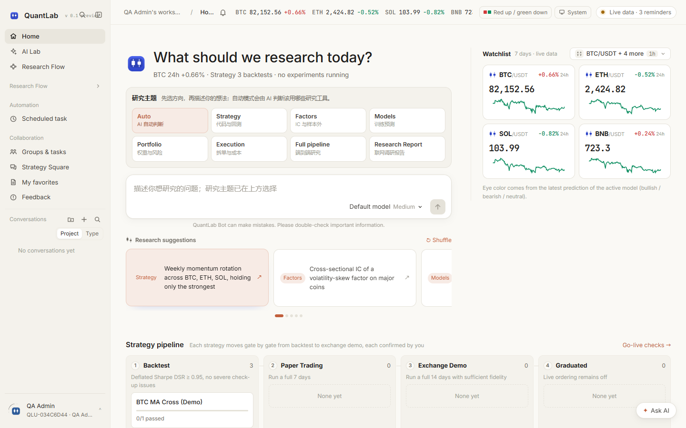

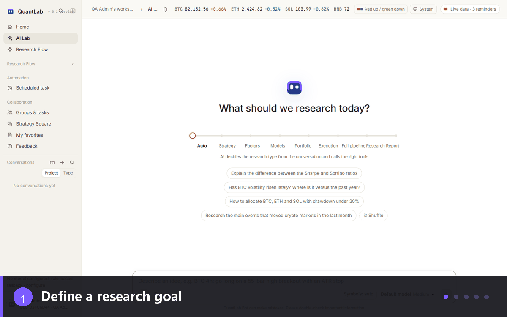

*Research loop: goal → multi-agent collaboration → strategy backtest → robustness review → conclusion*

For a quick tour without local installation, use the **GitHub Codespaces** link above. After the environment opens, run `bash scripts/dev.sh` and open the forwarded port `8000`. For a local deployment, use the quick start below.

## What QuantLab is

QuantLab is a conversation-first research platform:

- describe a research goal in the AI Lab;
- the Agent uses 51 platform tools across market data, strategy generation, backtests, factors, models, portfolios, execution and reports;
- every conclusion is tied to code hashes, parameters, data sources, cost assumptions and a run manifest;
- strategies must pass validation before paper trading, exchange demo or real-money micro live.

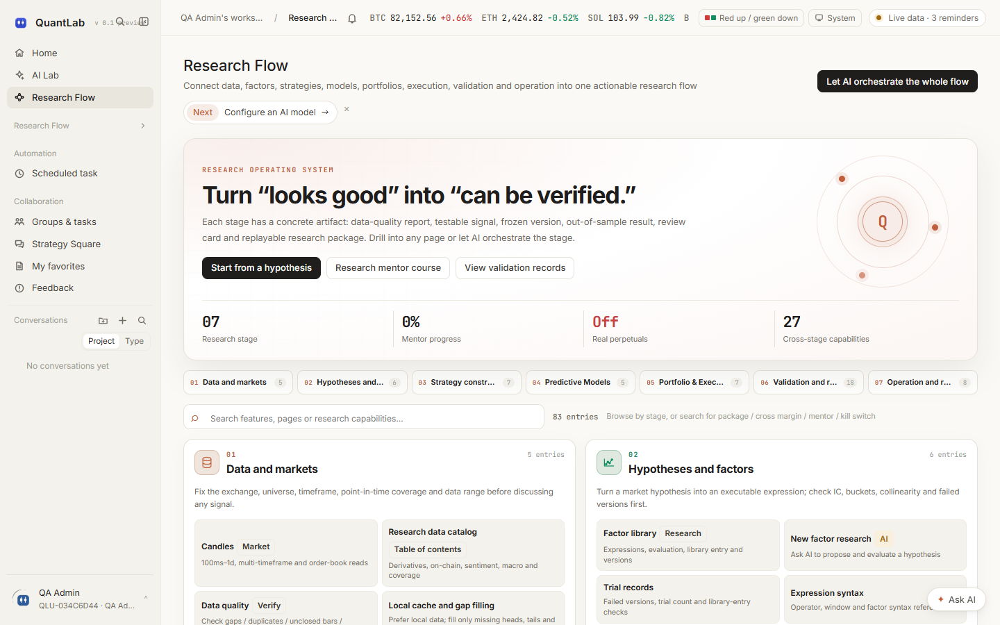

Research Flow consolidates **7 stages, 56 stage-level entries and 27 cross-stage capabilities**. It includes review gates, benchmarks, ledger v2, research packages, the mentor, role and prompt libraries, model services, collaboration, notifications, feedback, favorites and API/tool references.

---

## Quick start

```bash
mkdir -p secrets
python -c "from cryptography.fernet import Fernet;print(Fernet.generate_key().decode())" > secrets/secret.key
cp .env.example .env
docker compose up -d --build
```

Open `http://127.0.0.1:8000`. The first registered account becomes the deployment administrator.

Local development:

```bash
pip install -r requirements-dev.lock
pip install --no-deps -e .
cd web && npm ci && npm run build && cd ..
qagent migrate
qagent serve --with-worker
```

LLM providers can be configured in the Models page, through environment variables, or `agent.config.toml`.

---

## Core capabilities

### 1. AI Lab

- 7 research types: auto, strategy, factor, model, portfolio, execution, full pipeline/report;
- 21 slash commands, 51 tool commands and 7 home commands;
- 16 built-in roles with parallel review, conflict resolution, red-team challenges and research auditing;
- background jobs report back to the conversation.
- first-registration QuantLab Bot onboarding: goal → multi-agent review → backtest and Review Gate → next steps; skippable and replayable from the account menu.

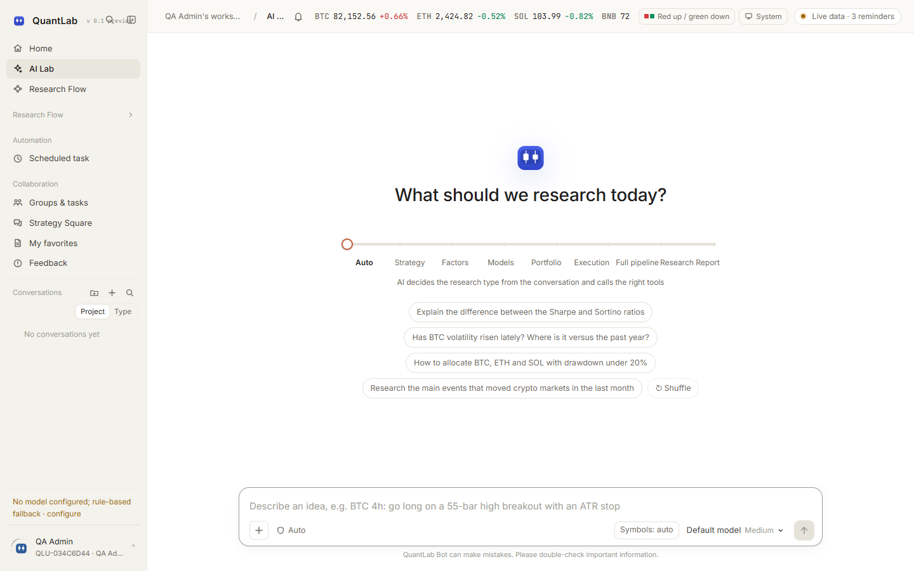

### Research mentor

Seven lessons cover hypothesis, data point-in-time, signal causality, backtests and benchmarks, robustness and multiple testing, perpetual risk, and execution/launch.

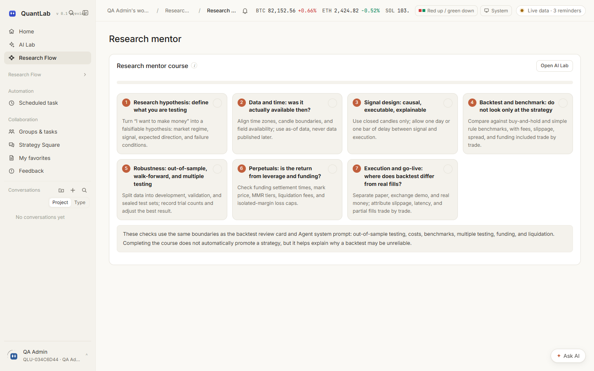

### 2. Strategy development

- rule DSL v2 with forms and JSON sharing one schema;
- JoinQuant-style Python SDK with 52 injected names;
- Freqtrade import with short/leverage support on derivatives;
- immutable versions: `DRAFT → VALIDATED → FROZEN → ARCHIVED`.

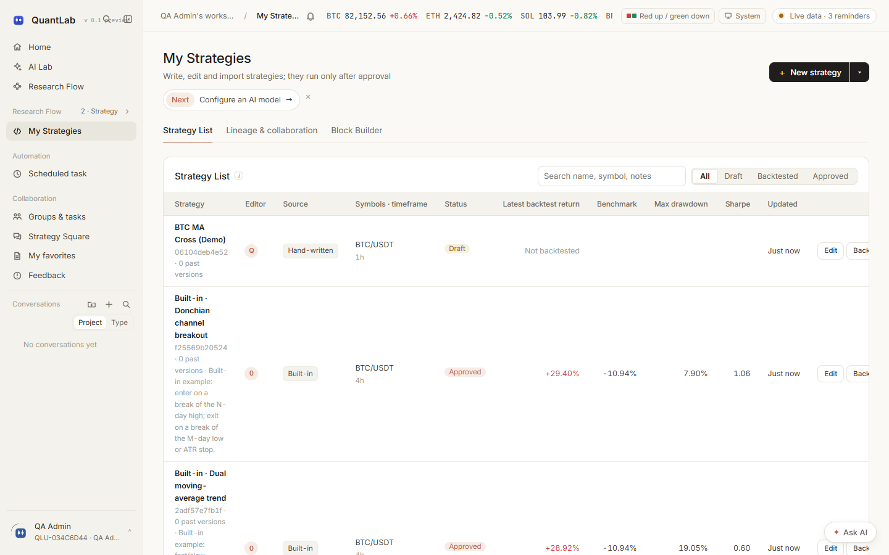

### 3. Backtests and validation

- event-driven backtests with a Decimal double-entry ledger;
- next-bar execution, costs, liquidity caps and no future data;
- grid/Optuna optimization, walk-forward, PBO/CSCV, cost stress and experiment ledger;
- Research Review Gate blocks high-severity promotions;
- strategy, buy-and-hold and simple-rule benchmark curves.

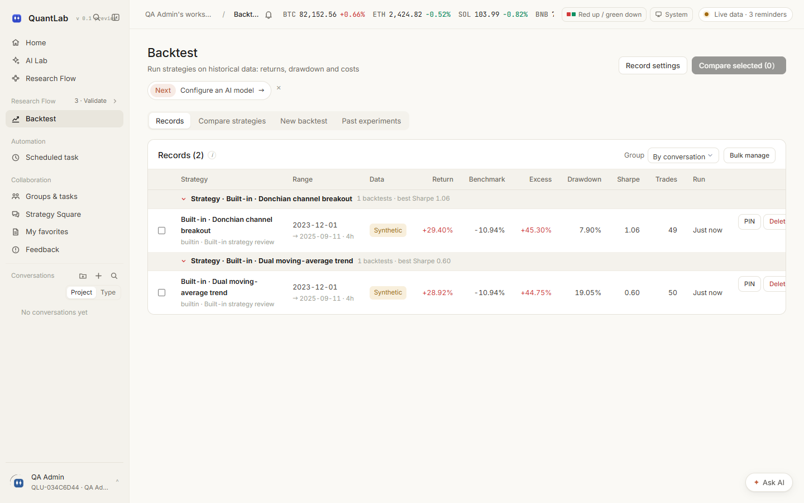


### 4. Execution and run modes

- paper sessions with worker checkpoints and crash recovery;
- Binance/OKX/Bybit exchange demo accounts;
- micro live for small real spot trades;
- real perpetuals for Binance/OKX linear USDT-M;
- live comparison and execution attribution from CSV or read-only APIs;
- reproducible research packages with verification and replay.

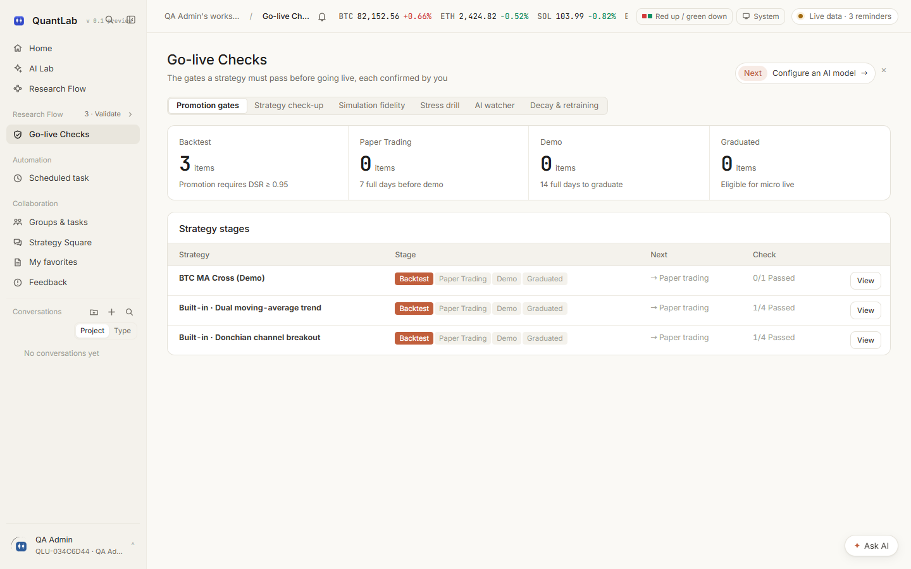

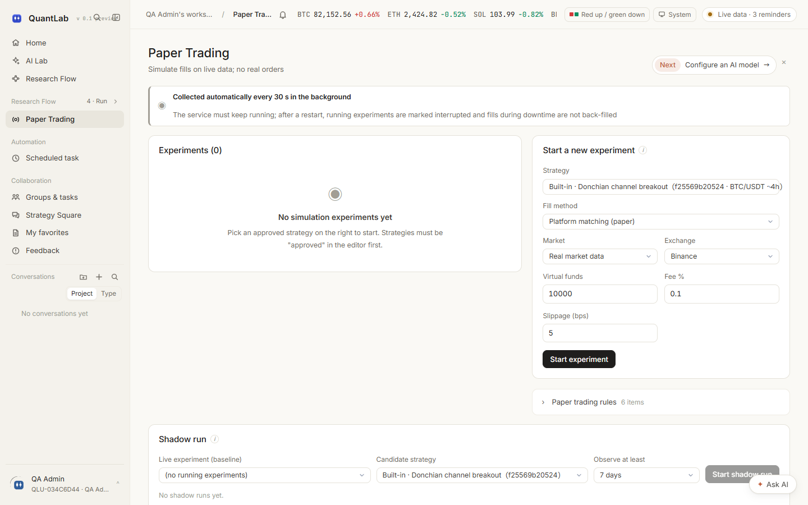

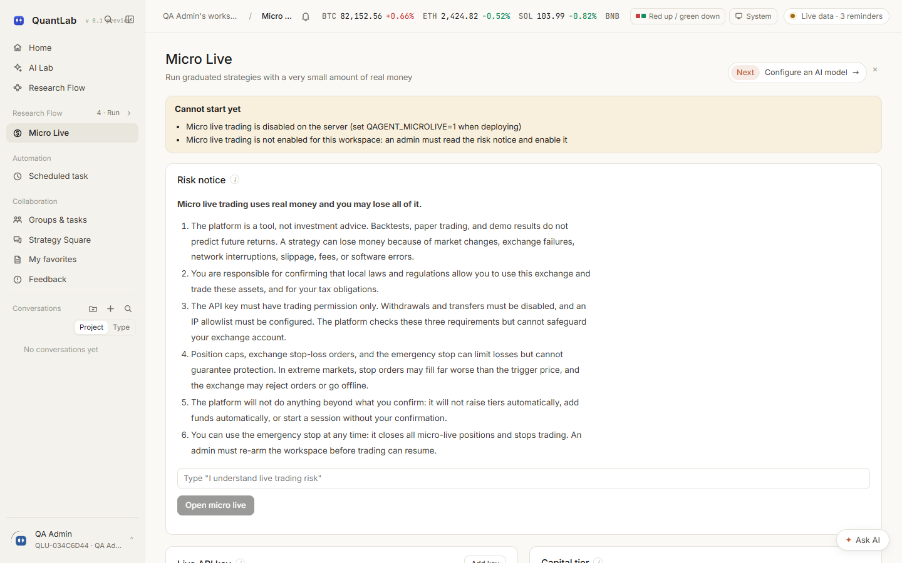

### 5. Data and operations

- Binance/OKX/Bybit public data, local cache, gap filling and quality checks;
- research data catalog and point-in-time conventions;
- workspace roles, groups, mentions, notifications and audit logs;
- group and Strategy Square replies mention the person by default (deletable as one token, blue and clickable to their profile); you can @ mutual follows in the square, mutual follows get a one-to-one conversation created automatically, and any reply can jump straight into a direct message;
- personal profile: choose which factors, strategies, backtests, models and simulated P&L to show (reorder or hide them); profile editing lives in Settings · My account;
- TOTP, quotas, idempotency, CSRF and Linux isolation.

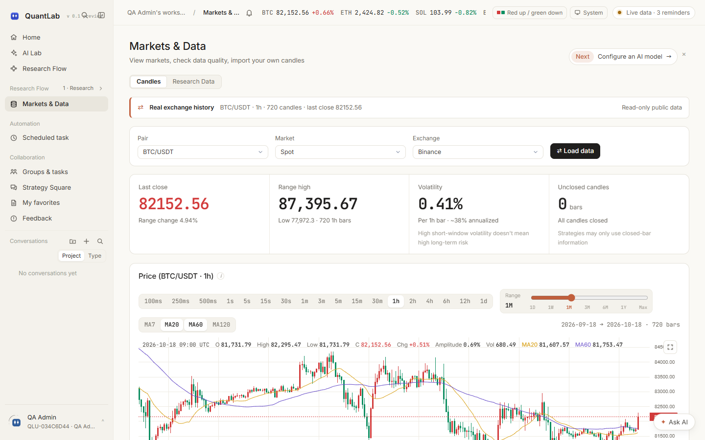

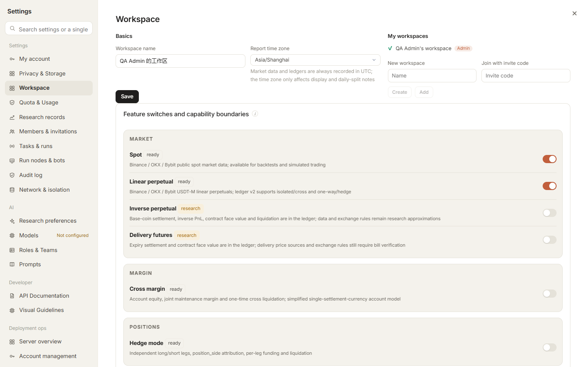

---

## Architecture

```
React 18 + TypeScript + Vite (browser)
   │  SSE (lab events) / WebSocket (run events) / polling
   ▼
API process  qagent serve
   ├─ authentication, workspace isolation, CSRF and idempotency
   ├─ queues long-running work instead of executing it
   └─ serves the built frontend from web/dist
        │
        ▼
PostgreSQL / SQLite (40 tables) + JSON collection storage
        │
        ▼
Worker process  qagent worker
   ├─ backtests / optimization / parameter tournaments / stress runs
   ├─ paper-trading driver with checkpoints on every bar
   ├─ AI Agent turns
   └─ isolated Python strategy subprocesses
```

- The control plane and execution plane are separated with single-lease claiming and fencing heartbeats.
- Redis is only a wake-up channel; the system falls back to database polling.
- Monetary values, quantities and prices use `DECIMAL_T` (`NUMERIC(38,18)` on PostgreSQL, `TEXT` on SQLite) to avoid floating-point drift.

<details>
<summary><strong>Safety boundary: no real-money path is enabled by default</strong> (open this after deciding to deploy or contribute)</summary>

- **No real-order path is enabled by default.** Read-only accounts, paper trading and exchange demo accounts never touch real money.
- **Micro live** is a separately gated real-money channel limited to Binance/OKX spot and graduated strategies.
- **Real perpetuals** are another independent channel limited to Binance/OKX linear USDT-M, disabled by default and protected by a dedicated secret store, admin confirmation, account checks, exposure/leverage/daily-loss caps, exchange stops and a kill switch.
- All results are for research only and are **not investment advice**.

---

</details>

## Verification status

| Check | Result |
|---|---|
| Ruff lint / formatting | Passed |
| Full backend suite | **1,208 passed / 4 skipped** |
| TypeScript + Vite production build | Passed |
| Research Flow coverage audit | 30/44 direct, 8 contextual, 6 non-research |
| Playwright E2E | **33 passed** |
| English UI crawl | 0 visible Chinese UI strings on checked pages |
| API snapshot | 604 operations / 513 paths |

See the [Test and Verification Report](docs/Test-and-Verification-Report.en.md).

---

## Roadmap

### Now · `v0.1.0-preview.1`

- Stabilize self-hosted deployment, upgrades and data migration;
- Improve model-provider presets, error messages and connection reliability;
- Complete API, strategy-protocol, operations and English documentation;
- Continue expanding PostgreSQL and SQLite test coverage.

### Next

- Publish a public read-only online demo so visitors can inspect a complete AI research run without deploying;
- Add a one-command image and a shorter first-run path;
- Expand data providers, execution simulation and exchange demo adapters;
- Publish a plugin/tool extension interface with examples;
- Label clear `good first issue` entry points for contributors.

### Later

- Additional asset classes and cross-market research;
- Finer-grained team permissions, audit and research-asset governance;
- Interoperable reproducible research packages, model cards and strategy packages.

> The roadmap will evolve with feedback. Start with [Issues](https://github.com/NagisaShip/quantlab/issues) or [CONTRIBUTING.md](CONTRIBUTING.md).

## Documentation

| Document | Content |
|---|---|
| [Documentation index](docs/README.en.md) | Reading order and capability boundaries |
| [Platform introduction](docs/Platform-Introduction.en.md) | Screenshots, feature map and workflows |
| [Test and verification report](docs/Test-and-Verification-Report.en.md) | Checks, tests and release checklist |
| [Strategy protocol](docs/Strategy-Protocol-and-Data-Conventions.en.md) | Events, signals, matching, ledger and metrics |
| [Exchange demo and packages](docs/Exchange-Demo-Trading-and-Strategy-Packages.en.md) | `.qstrat`, `qrun` and demo trading |
| [Operations and recovery](docs/Operations-and-Recovery-Manual.en.md) | Deployment, recovery, backup and real-money controls |
| [Isolation matrix](docs/Isolation-Capability-Matrix.en.md) | Linux/Windows isolation status |
| [Account integration](docs/Personal-Account-Integration-Guide.en.md) | CSV and read-only API keys |
| [API reference](docs/API-Reference.en.md) | English guide, complete endpoint index and OpenAPI contract |

---

## Perpetual capability boundary

| Entry | Spot | Perpetuals |
|---|---|---|
| Native backtest / AI Lab | Binance / OKX / Bybit | Linear, inverse and delivery; isolated/cross and one-way/hedge |
| `.qstrat` | Supported | Linear, inverse and delivery packages with golden-answer verification |
| Freqtrade import | Long-only spot | `can_short` / `leverage()` on derivatives |
| Micro live | Binance / OKX spot | Not supported |
| Real perpetuals | — | Binance / OKX linear USDT-M with separate safety controls |

Exchange-specific liquidation rules remain auditable research approximations and must be verified against exchange account bills.

## Known limitations

1. Windows isolation is process-only; POSIX resource and network isolation require Linux.
2. Micro live is Binance/OKX spot only.
3. Read-only synchronization has exchange lookback limits.
4. Backtest matching is bar-based; order-book execution lives in a separate simulation module.
5. `page-research` remains about 624KB after minification.

---

## Contributing

**Primary contributors: GitHub users [jamesusa99](https://github.com/jamesusa99) and [NagisaShip](https://github.com/NagisaShip).**

Please report security issues privately as described in [SECURITY.md](SECURITY.md).

## Contact

Email: [luoyangyuan110@gmail.com](mailto:luoyangyuan110@gmail.com)

## License

[MIT](LICENSE)
