# QuantLab v 0.1 preview

<div align="center">

**以 AI 研究室为核心的加密货币量化研究与仿真验证平台**

写策略 → 回测 → 参数稳健性检验 → 纸面模拟 → 交易所模拟盘 → 微实盘 → 实盘对照

[中文](README.md) | [English](README.en.md)

[](https://www.python.org/)
[](https://www.typescriptlang.org/)
[](docs/测试与验证报告.md)
[](LICENSE)

</div>

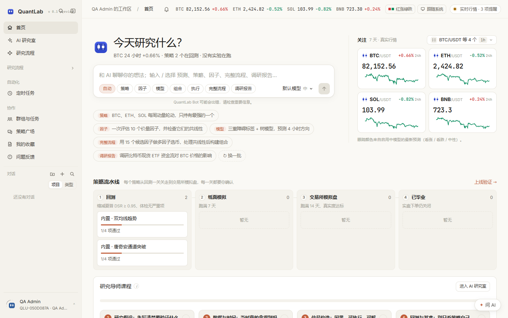

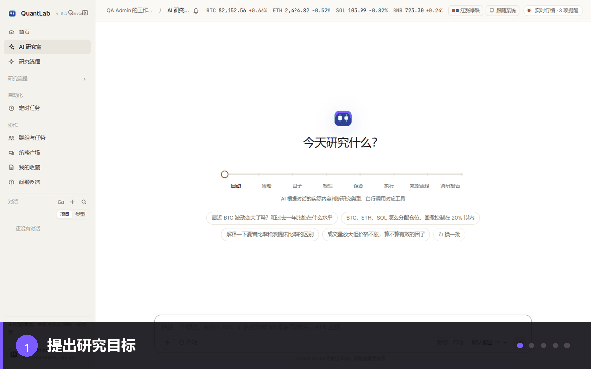

*研究闭环：提出目标 → 多 Agent 协作 → 策略回测 → 稳健性审查 → 研究结论*

> **先看它怎么工作：** 在 AI 研究室描述研究目标，多个 Agent 分工协作，调用平台工具完成策略开发、回测和审查，最后给出可复现、可复核的研究结论。

> **Preview release:** interfaces, data conventions and capabilities may change before a stable release. 当前为 `v 0.1 preview`，接口、数据口径与功能边界仍可能调整。

---

## ⚠️ 安全边界

- **默认没有任何真实下单路径。** 只读账户、纸面模拟和交易所模拟盘都不会动真钱。
- 平台内置**微实盘**：一条默认关闭、只支持 Binance / OKX 现货、只允许“已毕业”策略以小额真实资金运行的通道。
- 打开微实盘需要同时满足：部署者设置 `QAGENT_MICROLIVE=1`、工作区管理员确认风险告知、每次启动输入确认码；交易所止损必挂，支持一键平仓停止。
- **真实永续**是独立通道：使用 `QAGENT_REAL_PERP=1`，独立密钥目录、管理员确认码、期货账户自检、单笔/总名义/杠杆/日亏限制、交易所止损和 `real_perp.KILL` 自动急停；不复用微实盘开关。
- 所有回测、模拟和 AI 结论都只用于研究，**不构成投资建议**，也不承诺收益。

> 微实盘与真实永续都是平台设计的一部分，不是隐藏功能；未开启时相关接口整体不可用。

---

## 平台是什么

QuantLab 不是一个“填表单跑回测”的单点工具，而是一个**对话式研究平台**：

- 用户在「AI 研究室」描述研究目标；
- AI 在平台的 51 个工具上调行情、写策略、跑回测、评估因子、训练模型、做组合优化与执行仿真；
- 每个结论都落回可复现的记录：代码哈希、参数、数据来源、成本假设、运行清单；
- 研究通过上线验证后，才进入纸面模拟、模拟盘或微实盘。

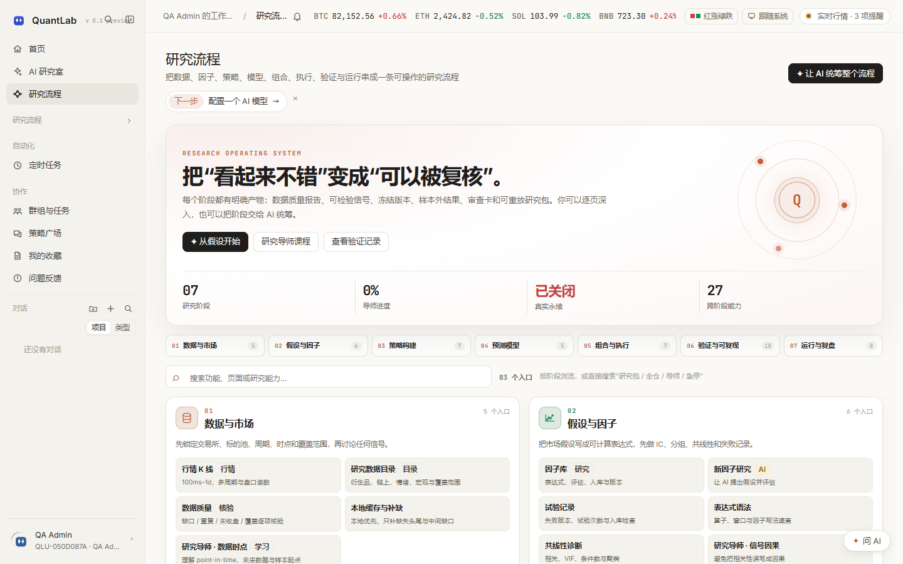

研究流程把 **7 个阶段、56 个阶段入口和 27 个跨阶段能力** 放在同一页：数据、因子、策略、模型、组合执行、验证与运行按研究顺序展开；角色库、提示词库、模型服务、AI 研究室、群组任务、通知、问题反馈、收藏和 API 工具参考也按“研究配置 / 协作复用”并入。工作区关闭的能力直接标注“未开启”，客户端入口仍由服务端能力矩阵最终裁决。

---

## 核心能力

### 1. AI 研究室

7 种研究类型：自动、策略、因子、模型、组合、执行、完整流程 / 调研报告。

- 21 个研究室斜杠命令 + 51 个工具命令 + 7 个首页命令；
- 16 个内置角色，支持并行评审、团队讨论、红队质疑、研究审计；
- 后台任务完成后主动回到对话汇报；AI 自己查到结果时取消重复跟进；
- 结构化内容块：回测报告、净值曲线、因子分层、模型诊断、执行仿真、调研报告。

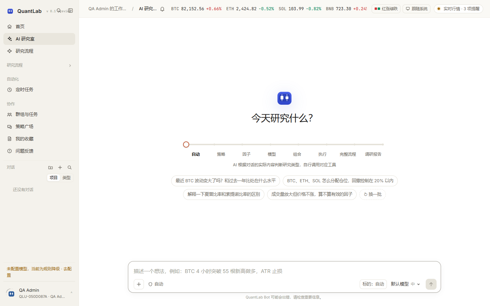

#### 研究导师

独立的研究导师页面把研究方法拆成七课：假设、数据时点、信号因果、回测与基准、稳健性与多重检验、永续风险、执行与上线。每课包含检查项、练习和红旗，并与回测 Review Gate、Agent 系统提示保持同一套研究边界。工作区关闭课程时会显示明确状态，不再停留在无限加载。

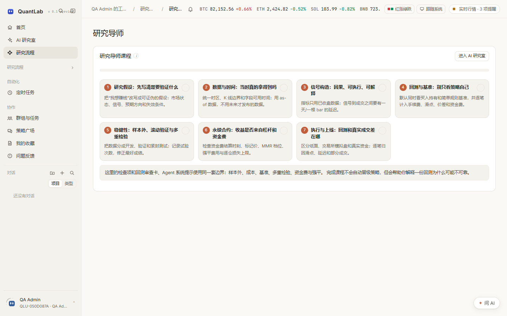

### 2. 策略开发

- **规则 DSL v2**：零代码表单、指标 / 条件 / 轮动 / 风控，表单与 JSON 共用一份 schema；
- **Python SDK**：聚宽式 API，52 个注入名，支持 `run_daily`、`history`、`order_target_percent`、因子 / 模型预测等；
- **Freqtrade 导入**：兼容常见策略包；在线性永续上支持 `can_short` 与 `leverage()`，现货仍只做多；
- 版本不可改写：`DRAFT → VALIDATED → FROZEN → ARCHIVED`，改参数自动生成新版本。

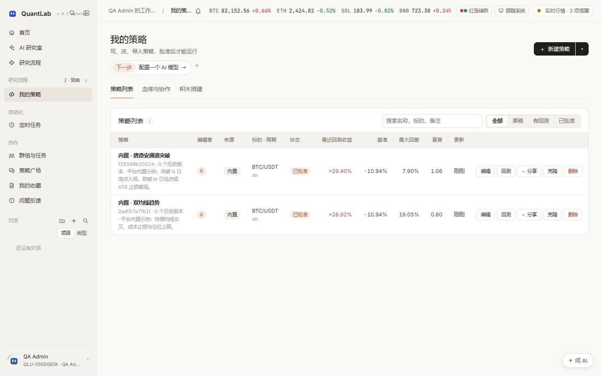

### 3. 回测与优化

- 事件驱动回测，Decimal 复式账本，逐笔可对账；
- 下一根 bar 开盘价 ± 成本成交，避免未来数据；
- 参数网格 / Optuna 贝叶斯搜索、多目标优化、样本内 / 样本外、walk-forward、PBO / CSCV；
- 成本压力测试、检查点恢复、试验台账（按试验次数修正最好成绩）；
- **Research Review Gate**：每次回测自动生成审查卡（通过 / 有条件通过 / 不通过 / 证据不足），高严重度问题阻断批准与晋级；
- **双基准**：策略、买入持有、SMA 20/60 简单规则三条曲线同时展示。

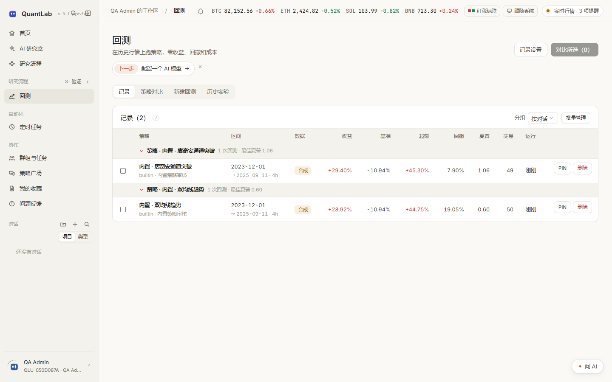

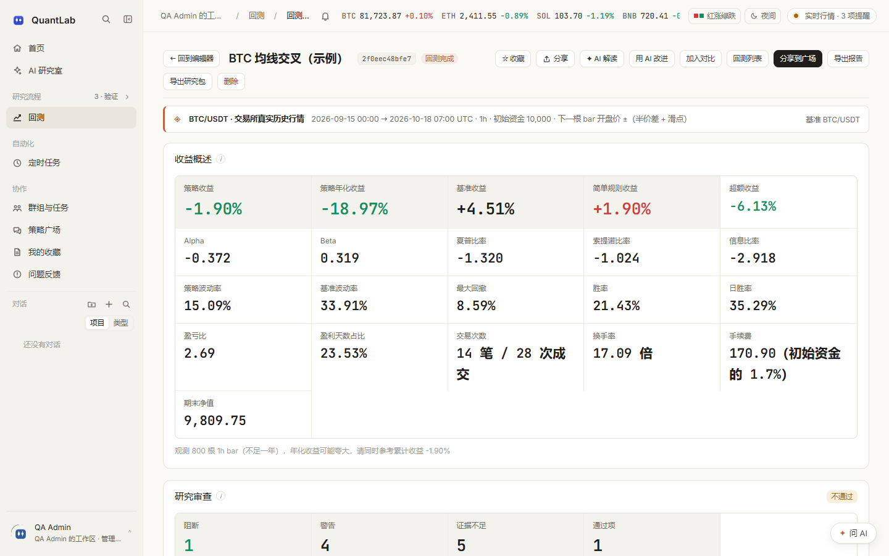

### 4. 验证与运行

- **上线验证**：回测、纸面模拟、模拟盘三关，逐关人工确认；
- **纸面模拟**：真实行情、独立 worker、每根 bar 检查点、崩溃恢复不重复成交；
- **交易所模拟盘**：Binance / OKX / Bybit 模拟账户，核对真实撮合；
- **微实盘**：小额真实资金，资金档位、交易所止损、启动确认码、一键停止；
- **真实永续**：Binance/OKX USDT-M 独立通道，支持全仓/对冲、交易所止损和自动急停；
- **实盘对照**：CSV / 只读 API，逐笔归因执行缺口、滑点与时机；
- **研究包**：一键导出代码、数据、资金费、参数、结果与审查报告，可校验并重放哈希。

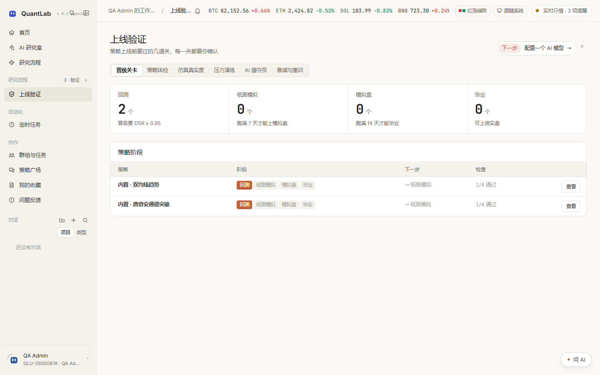

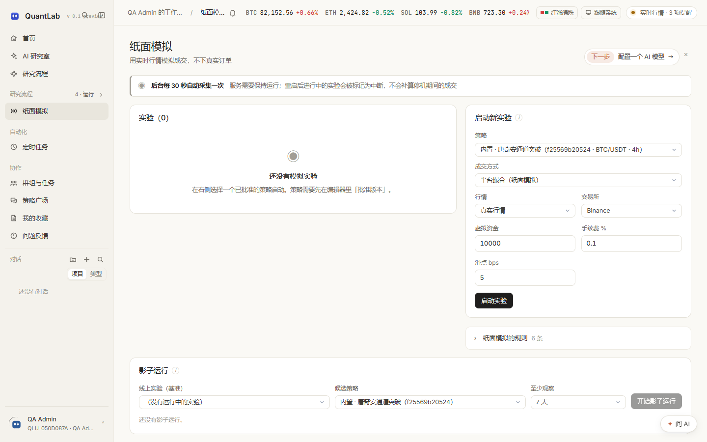

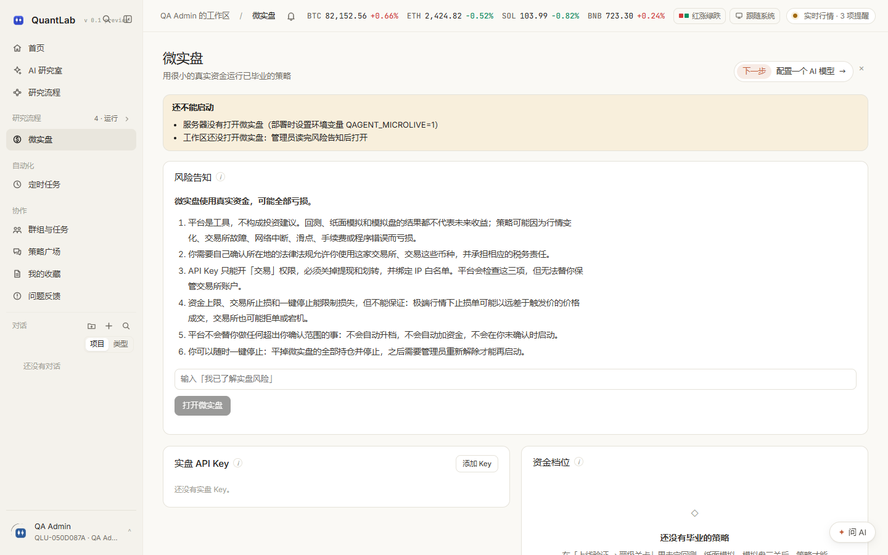

### 5. 协作与社区

- 工作区、成员、三级角色（admin / member / reviewer）、配额与审计；
- 群组、私聊、@ 成员、引用回测 / 策略 / 文件、任务摊派；
- 策略广场：冻结代码 + 回测清单，一键克隆、AI 审稿；
- 通知中心、问题反馈、在线状态、TOTP 双因素。

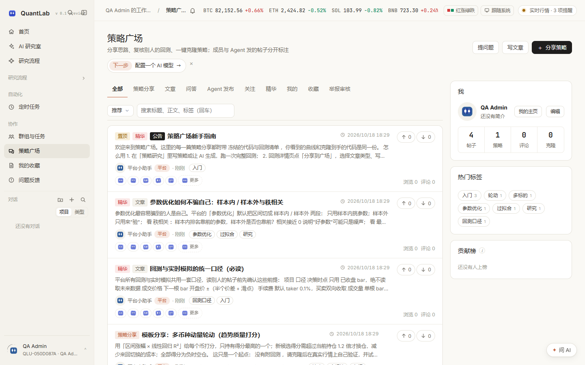

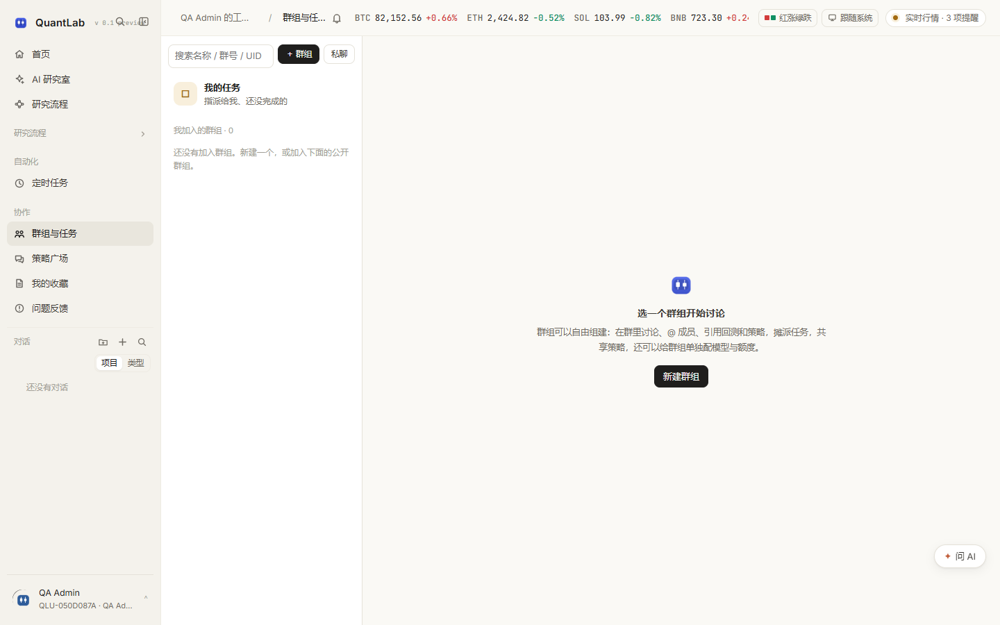

---

## 架构

```
浏览器（React 18 + TypeScript + Vite）
   │  SSE（研究室事件）/ WebSocket（run 事件）/ 轮询
   ▼
API 进程  qagent serve
   ├─ 鉴权、工作区隔离、CSRF、幂等
   ├─ 只入队，不执行长任务
   └─ 静态站点服务（web/dist）
        │
        ▼
PostgreSQL / SQLite（40 张表）+ JSON 集合存储
        │
        ▼
Worker 进程  qagent worker
   ├─ 回测 / 优化 / 参数擂台 / 压力演练
   ├─ 纸面模拟常驻驱动（每 bar 检查点）
   ├─ AI Agent 回合
   └─ Python 策略隔离子进程（Linux 下资源上限 / 降权 / 断网）
```

- 控制面 / 执行面分离，单租约认领 + fencing 心跳；
- Redis 仅作唤醒通道，缺省退回数据库轮询；
- 金额、数量、价格在 SQL 中用 `DECIMAL_T`（PG `NUMERIC(38,18)`，SQLite `TEXT`）保存，避免浮点误差。

---

## 快速开始

### Docker Compose（推荐）

```bash
mkdir -p secrets
python -c "from cryptography.fernet import Fernet;print(Fernet.generate_key().decode())" > secrets/secret.key
cp .env.example .env
# 编辑 .env，至少修改 POSTGRES_PASSWORD
docker compose up -d --build
```

打开 <http://127.0.0.1:8000>，第一个注册的账号成为部署管理员。

### 单机开发

**Windows:**

```powershell
powershell -ExecutionPolicy Bypass -File scripts\dev.ps1
```

**Linux / macOS:**

```bash
bash scripts/dev.sh
```

脚本会安装依赖、构建前端、执行迁移，并启动 API 与 Worker。

**手动启动：**

```bash
pip install -r requirements-dev.lock
pip install --no-deps -e .
cd web && npm ci && npm run build && cd ..
qagent migrate
qagent serve --with-worker   # 单机：API + 守护 worker，http://127.0.0.1:8000
# 或分开部署：qagent worker &  +  qagent serve

# 在回环地址（127.0.0.1 / localhost）启动 serve 时，若没有在线 worker 会自动拉起；
# 已有外部 worker 时不会重复启动，worker 退出后会由守护线程自动恢复。
```

> 无外网时行情会明确报“未接入数据”，不会用合成数据冒充真实行情。演示页与压力演练中的示意数据会单独标注。

### 配置大模型

三种方式任选其一：

1. 界面「模型」页登记服务与密钥（部署管理员）；
2. 环境变量：`DEEPSEEK_API_KEY`、`OPENAI_API_KEY`、`ANTHROPIC_API_KEY` 等；
3. 复制 `agent.config.example.toml` 为 `agent.config.toml`。

支持 DeepSeek、通义千问、Kimi、智谱、OpenAI 兼容接口、Anthropic、Ollama、vLLM 等。

---

## 当前验证状态（2026-10-18）

| 检查 | 结果 |
|---|---|
| `ruff check src tests scripts` | ✅ All checks passed |
| `ruff format --check src tests scripts` | ✅ 338 files already formatted |
| `tsc -b && vite build`（`web/`） | ✅ 通过 |
| `pytest -q`（完整套件） | ✅ **1,203 passed / 4 skipped** |
| 定向后端测试（账本 v2 / 真实永续 / 资金费 / 能力矩阵） | ✅ 60 passed |
| 英文界面逐页巡检 | ✅ 35 个登录页 + 未登录首页无 UI 中文残留（系统错误文本、运行时路径除外） |
| 浏览器端 E2E（Microsoft Edge，关闭录像） | ✅ 32 passed |
| API 快照 | 由 `scripts/gen_api_doc.py` 重新生成（601 个操作 / 511 条路径） |

完整结果与复现命令见 [测试与验证报告](docs/测试与验证报告.md)。

---

## 规模（当前工作区实测）

| 维度 | 数值 |
|---|---:|
| Python 文件 / 行数（`src/quant_agent`） | 217 / 100,338 |
| 前端 TS/TSX 文件 / 行数 | 166 / 42,624 |
| CSS 文件 / 行数 | 23 / 7,890 |
| 测试文件 / 收集用例 | 95 / 1,205 |
| API 路由模块 / 操作 / 路径 | 35 / 601 / 511 |
| 前端路由 / 侧栏入口 | 44 / 24 |
| 数据库迁移 / 表 | 18 / 40 |
| 内置 Agent 角色 / 工具 | 16 / 51 |

> 行数口径：源文件总行数（含注释与空行），由当前工作区直接统计。

---

## 文档

| 中文 | English | 内容 |
|---|---|---|
| [文档索引](docs/README.md) | [Documentation Index](docs/README.en.md) | 当前有效文档、阅读顺序与能力边界 |
| [平台介绍](docs/平台介绍.md) | [Platform Introduction](docs/Platform-Introduction.en.md) | **推荐从这里开始**：最新截图、功能地图与使用场景 |
| [测试与验证报告](docs/测试与验证报告.md) | [Test & Verification Report](docs/Test-and-Verification-Report.en.md) | 静态检查、测试、构建、E2E 与发布清单 |
| [隔离能力矩阵](docs/隔离能力矩阵.md) | [Isolation Matrix](docs/Isolation-Capability-Matrix.en.md) | Linux / Windows 下各隔离能力的真实状态 |
| [策略协议与数据口径](docs/策略协议与数据口径.md) | [Strategy Protocol](docs/Strategy-Protocol-and-Data-Conventions.en.md) | 事件模型、信号协议、撮合规则、指标口径 |
| [运维与恢复手册](docs/运维与恢复手册.md) | [Operations & Recovery](docs/Operations-and-Recovery-Manual.en.md) | 部署、状态机、检查点恢复、备份、微实盘开关 |
| [API 参考](docs/API参考.md) | [API Reference](docs/API-Reference.en.md) | 601 个操作；英文索引与机器可读版本 [openapi.json](docs/openapi.json) |
| [个人账户接入教程](docs/个人账户接入教程.md) | [Account Integration](docs/Personal-Account-Integration-Guide.en.md) | CSV 导入与只读 Key 接入 |
| [交易所模拟盘与策略包](docs/交易所模拟盘与策略包.md) | [Exchange Demo & Packages](docs/Exchange-Demo-Trading-and-Strategy-Packages.en.md) | 模拟盘接入与 `.qstrat` 策略包 |

---

### 永续能力边界

| 入口 | 现货 | 永续 |
|---|---|---|
| 原生回测 / AI 研究室 | ✅ Binance / OKX / Bybit | ✅ 线性 / 币本位反向 / 交割；逐仓/全仓、单向/对冲 |
| `.qstrat` 策略包 | ✅ | ✅ 线性 / 反向 / 交割包；导入复核标的后缀、合约类型、模式与标准答案 |
| Freqtrade 导入 | ✅ 现货多头 | ✅ `can_short` / `leverage()`；需管理员开启开关并使用衍生品标的 |
| 微实盘 | ✅ Binance / OKX 现货 | ❌ 微实盘保持现货专用 |
| 真实永续 | — | ✅ Binance / OKX 线性 USDT-M；独立开关、确认码、止损、自动急停 |

## 工作区功能开关

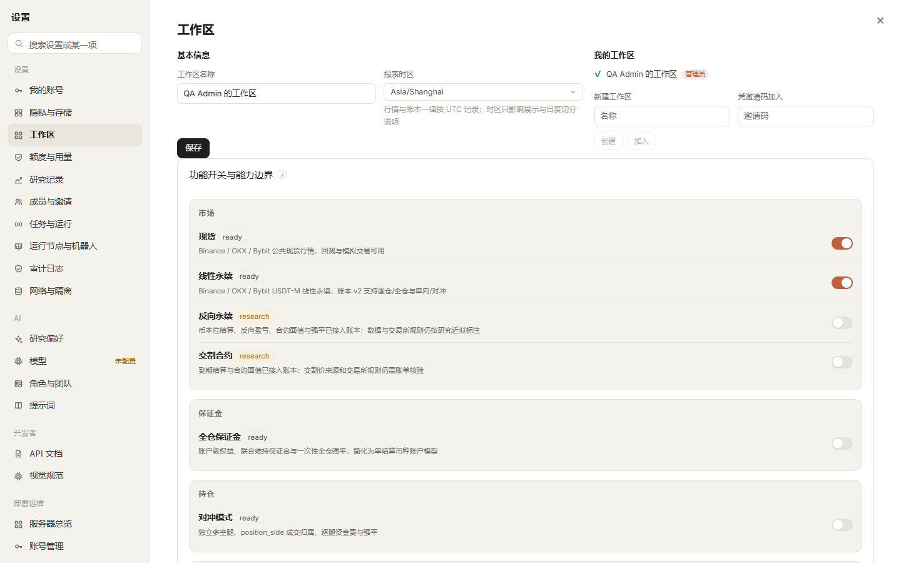

工作区管理员可在「设置 → 工作区 → 功能开关与能力边界」动态开关现货、线性/反向/交割永续、全仓、对冲、真实资金现货、真实资金永续、`.qstrat` 永续包、Freqtrade 做空/杠杆与研究导师。前端、API、Agent 工具与文档读取同一份注册表，服务端始终是最终裁决者；未实现或已阻断的能力仍不能打开。

## 已知限制

1. **隔离能力与操作系统相关**：Linux 下才具备资源上限、降权与网络命名空间；Windows 开发环境只能做到进程隔离，平台会如实显示“部分生效”。
2. **微实盘只支持 Binance / OKX 现货**，且要求 Key 具备交易权限、关闭提现 / 划转、绑定 IP 白名单；OKX 的 IP 白名单状态依赖交易所接口返回。
3. **反向/交割与全仓/对冲已有账本 v2 支持，但交易所规则仍是研究近似**：必须用账户账单核验 MMR、标记价、资金费和交割价；不能把研究结果描述成交易所生产级风险引擎。
4. **只读同步有回溯上限**：Binance 1,000 条、OKX 100 条 / 页；需要完整历史时请用 CSV 导入。
5. **回测撮合基于 K 线**；盘口队列、冲击与拆单算法在独立的执行仿真模块中，两者不共用。
6. **前端包体仍可继续拆分**：循环 chunk 警告已消除，页面已按路由拆包，但 `page-research` 共享 chunk 约 624KB，仍有体积提示。

---

## 贡献与许可

**主要贡献者：GitHub 用户 [jamesusa99](https://github.com/jamesusa99) 与 [NagisaShip](https://github.com/NagisaShip)。**

欢迎贡献！请先阅读 [CONTRIBUTING.md](CONTRIBUTING.md)。安全问题请按 [SECURITY.md](SECURITY.md) 私下报告。联系邮箱：[luoyangyuan110@gmail.com](mailto:luoyangyuan110@gmail.com)。提交前请至少运行：

```bash
ruff check src tests scripts
ruff format --check src tests scripts
pytest -q
cd web && npm run build
```

本项目使用 [MIT License](LICENSE)。
