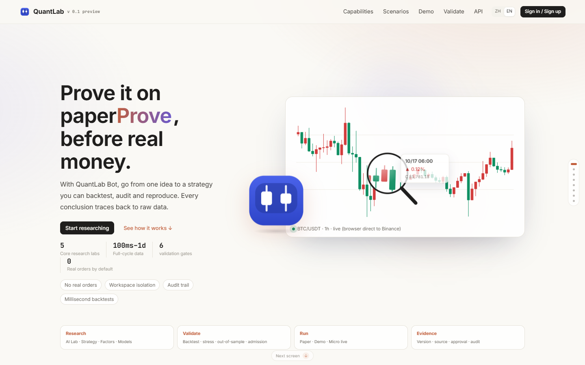
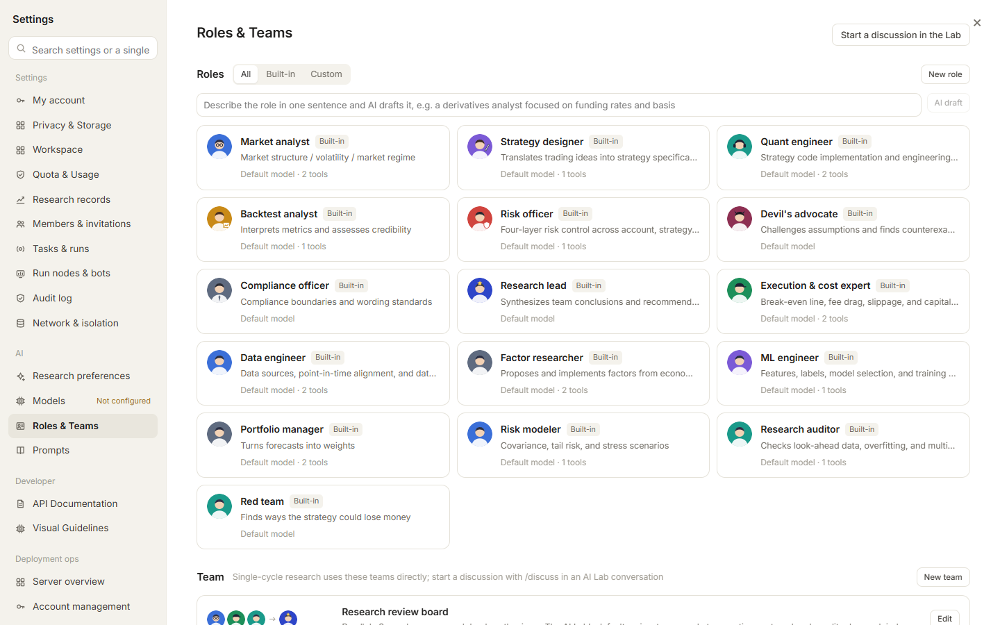
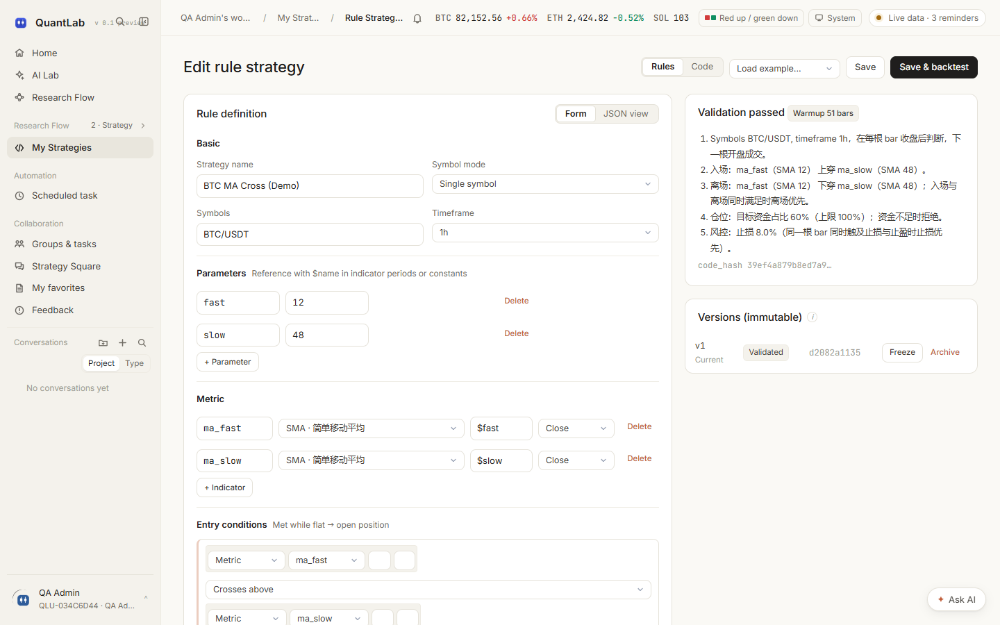
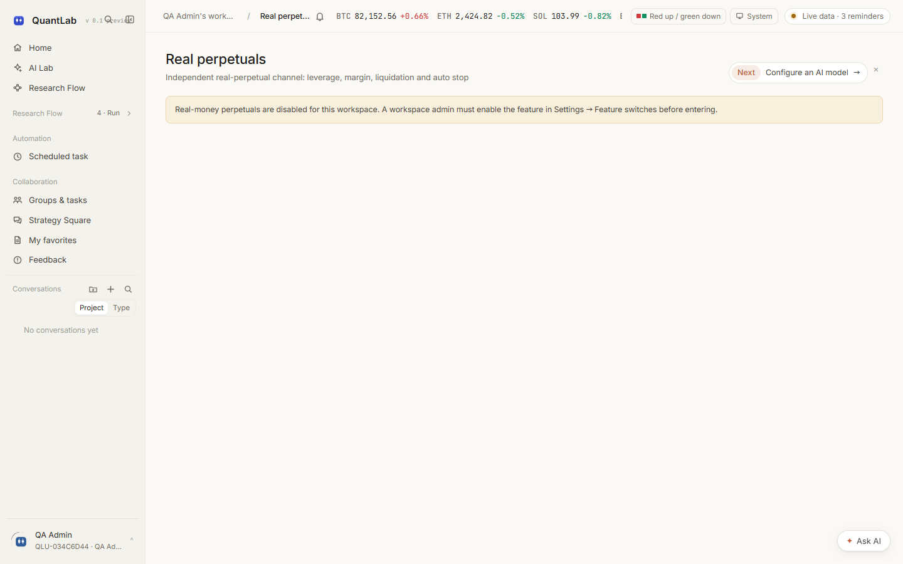
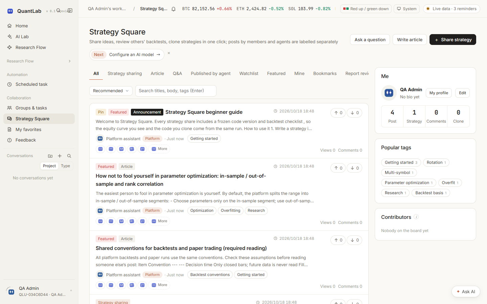
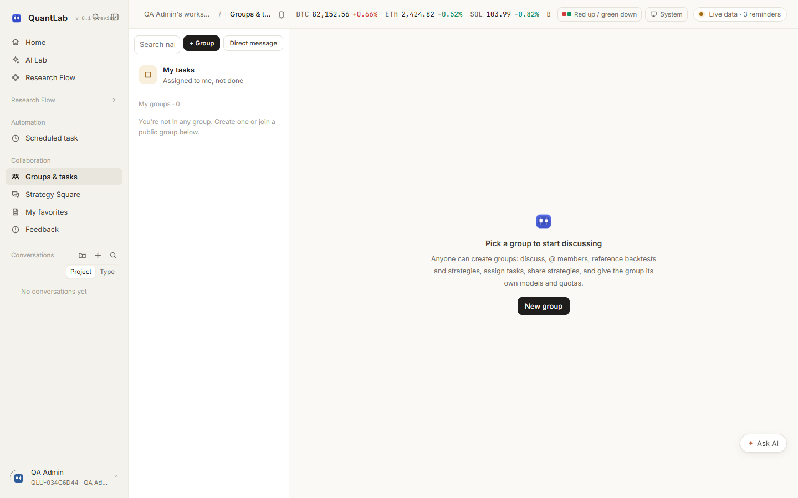
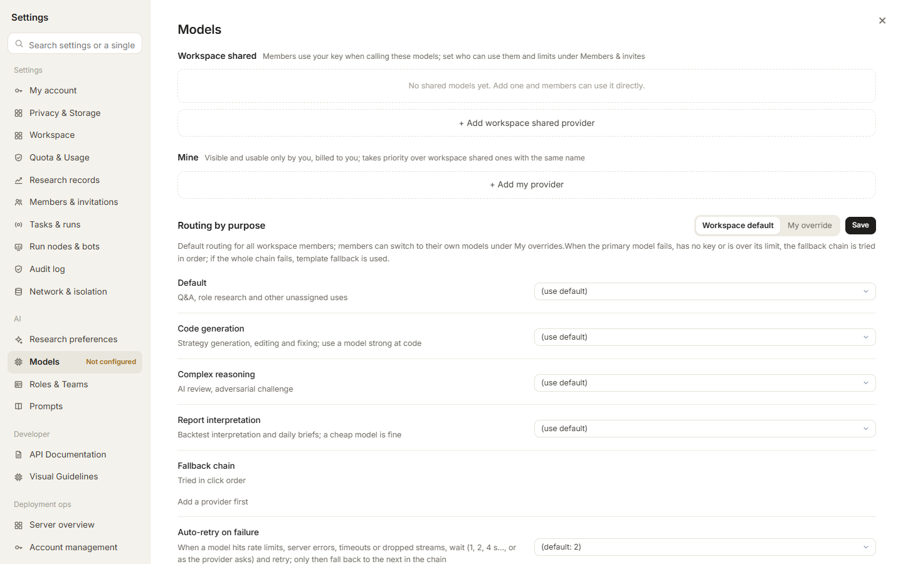

# QuantLab v0.1.0-preview.1 · Platform Introduction

> **A cryptocurrency quantitative research and simulation platform built around the AI Lab.**
> Preview release: interfaces and capabilities may change. Simulation is the default; real-money paths are separately gated and disabled by default.

[中文](平台介绍.md) | [Documentation index](README.en.md) | [Back to README](../README.md)

---

## 1. Positioning

QuantLab turns quantitative research into an auditable pipeline:

1. **Form a hypothesis** in the AI Lab, or start from a strategy template;
2. **Build a strategy** with the rule DSL (no code) or the JoinQuant-style Python SDK;
3. **Backtest** with an event-driven engine, Decimal ledger and reproducible run manifest;
4. **Stress the result** with in-sample/out-of-sample splits, walk-forward, PBO/CSCV and cost scenarios;
5. **Pass validation gates**: backtest → paper trading → exchange demo, with manual approval;
6. **Validate with small real money** only after graduation and only through the micro-live channel;
7. **Compare with live fills** by importing executions and attributing timing, slippage and implementation shortfall.



### What it is not

- It does not custody funds.
- It does not provide investment advice or promise returns.
- It is not a high-frequency market-making engine.
- It does not place real orders by default.

> **Real money is an explicit feature, not a hidden path.** Micro live supports Binance/OKX spot. Real perpetuals use a separate channel limited to Binance/OKX linear USDT-M. Both are disabled by default and require deployment, workspace-admin and per-start confirmation.

---

## 2. Home and research workspace

The home page puts the next research action first:

- conversation-first research entry with automatic research-type selection;
- watchlist symbols and live candles;
- recent backtests, active paper sessions and strategies awaiting review;
- validation progress, pipeline status and warnings.


### 2.1 Research Flow

Research Flow is the single entry point for the full research loop:

- **7 stages**: data and markets → hypotheses and factors → strategy construction → predictive models → portfolio and execution → validation and reproducibility → operation and review;
- **56 stage-level entries** with explicit deliverables and direct links to data, factors, strategies, backtests, validation, simulation and real-money surfaces;
- **27 cross-stage capabilities** grouped into research assurance, import/export, collaboration, research setup and operation;
- live search, category filters, mentor progress, real-perpetual safety status, workspace feature status and per-stage “Ask AI to coordinate” actions;
- `npm run qa:research` fails when a page is neither mapped into Research Flow nor explicitly classified as a contextual or non-research page.

---

## 3. AI Lab

### 3.1 Seven research types

| Type | What it does | Typical output |
|---|---|---|
| Auto | Chooses the appropriate research route | Strategy / factor / model / portfolio / execution |
| Strategy | Code or DSL → backtest → iterate | Draft, backtest report, improvement notes |
| Factor | Hypothesis → expression → IC / buckets / decay | Factor evaluation and library recommendation |
| Model | Label → train → leakage checks → deployment | Diagnostics and experiment comparison |
| Portfolio | Optimizer and constraints → stress test | Weights, risk report, scenarios |
| Execution | Execution-algorithm simulation and cost comparison | Execution plan, TCA, capacity curve |
| Full pipeline / report | Multi-stage research or web-backed investigation | Structured report with references |


### 3.2 Tools, roles and commands

- **51 Agent tools** covering market data, backtests, optimization, factors, models, portfolios, execution, collaboration and reports;
- **16 built-in roles**, including market analyst, strategy designer, quant engineer, backtest analyst, risk officer, devil’s advocate, compliance officer, research lead, execution/cost specialist, data engineer, factor researcher, ML engineer, portfolio manager, risk modeler, research auditor and red team;
- **21 lab slash commands + 51 tool commands + 7 home commands**;
- team review supports parallel statements, conflict resolution, red-team challenges and research-discipline checks.



### 3.3 Research mentor

The standalone mentor page contains seven lessons: hypothesis, data point-in-time, signal causality, backtests and benchmarks, robustness and multiple testing, perpetual-contract risk, and execution/launch. Each lesson includes checks, an exercise and red flags. Progress is persisted per user. When the feature is disabled, the page explains the state instead of waiting indefinitely.


---

## 4. Strategy development

### 4.1 Rule DSL v2

- Indicators: SMA, EMA, RSI, ATR, highest, lowest and return;
- comparisons, crossovers, logical and consecutive conditions;
- multi-symbol rotation with `rank{}`;
- stop-loss, take-profit, daily trade limits, drawdown pause and insufficient-funds behavior;
- limits: 12 indicators / 60 nodes / depth 6;
- forms and JSON share one schema; the server is the final validator.

### 4.2 Python SDK

- JoinQuant-style API: `initialize`, `run_daily`, `history`, `order_target_percent`, `set_benchmark`, `set_universe`, `set_order_cost` and more;
- 52 injected names;
- one strategy file can run in backtests, paper trading and live comparison;
- Python strategies run in a separate subprocess; Linux can add resource limits, privilege dropping and network isolation.

### 4.3 Versions

```
DRAFT → VALIDATED → FROZEN → ARCHIVED
```

Versions are immutable. Changing parameters creates a new version. `FROZEN` is required before paper trading and live comparison.



---

## 5. Backtests, optimization and validation

### 5.1 Backtest conventions

- only closed bars are visible;
- fills use the next bar open ± half spread and slippage;
- default taker fee is 0.1%, charged on both sides;
- one bar can fill at most 10% of its volume;
- rebalance tolerance is 0.5% of equity or 10 USDT;
- the first N bars are warm-up only;
- synthetic data validates workflow only, never a strategy conclusion.

### 5.2 Optimization

- grid search and Optuna Bayesian search;
- multi-objective optimization;
- in-sample/out-of-sample, walk-forward and PBO/CSCV;
- experiment ledger adjusts the best result for the number of trials;
- checkpoints prevent recomputing completed parameter combinations.

### 5.3 Validation gates

- backtest gate: returns, drawdown, trade count, cost assumptions and out-of-sample results;
- paper gate: live data, independent worker and checkpoint recovery;
- exchange-demo gate: real exchange simulation matching;
- every gate requires human approval; AI cannot promote a strategy automatically.


---

## 6. Run modes

| Mode | Capital | Fills | Purpose |
|---|---|---|---|
| Backtest | Virtual | Historical bars | Logic, costs and regime sensitivity |
| Paper | Virtual | Live bars + same matching code | 7-day / 30-day forward observation |
| Exchange demo | Virtual | Exchange demo matching | API and matching verification |
| Micro live | **Real, small** | Exchange matching | Limited live validation after graduation |
| Live comparison | Imported real fills | No trading | Attribution of simulation vs execution |

Paper sessions run in an independent worker, process one closed bar at a time and write a checkpoint after each bar. Recovery does not duplicate events or fills. The 7-day and 30-day checkpoints require 168 and 720 real hours.

### 6.1 Perpetual capability boundary

| Entry | Spot | Perpetuals |
|---|---|---|
| Native backtest / AI Lab | Binance / OKX / Bybit | Linear USDT-M, coin-margined inverse and delivery; isolated/cross and one-way/hedge |
| `.qstrat` | Supported | Linear, inverse and delivery packages; import verifies suffix, contract type, margin/position mode and golden answer |
| Freqtrade import | Long-only spot | `can_short` / `leverage()` on derivatives; workspace switch required |
| Micro live | Binance / OKX spot | Not supported |
| Real perpetuals | — | Binance / OKX linear USDT-M with separate switch, confirmation, stops and kill switch |

Ledger v2 records independent long/short legs, `position_side` attribution, account equity and joint liquidation, coin settlement, contract multiplier, delivery expiry, funding settlement currency, MMR tiers, liquidation fees and slippage. Exchange rules remain auditable research approximations and must be checked against account bills.

### 6.2 Real perpetuals

- separate deployment switch `QAGENT_REAL_PERP=1`, not shared with micro live;
- dedicated secret directory and connection set; trade-only keys, withdrawals/transfers disabled, IP allowlist required;
- only Binance/OKX linear USDT-M after futures-account checks;
- admin confirmation code and a second pre-start check;
- per-order and total notional, leverage, daily-loss caps, margin and position-mode declarations;
- exchange conditional stop required; `real_perp.KILL` or the kill switch pauses new entries and attempts to close exchange positions;
- Agents can inspect safety status but cannot enter confirmation codes or clear a kill state.



### 6.3 Micro live

- Binance/OKX spot only;
- deployment switch `QAGENT_MICROLIVE=1`;
- workspace admin acknowledges risk and enters the confirmation phrase;
- keys must be trade-capable, withdrawal/transfer-disabled and IP-restricted;
- default tiers 100 / 300 / 1,000 USDT, hard cap 10,000 USDT;
- graduated strategies only;
- exchange stop is mandatory; failure to place it pauses new entries;
- six-digit confirmation code valid for five minutes per start;
- one-click stop closes and stops all micro-live sessions.


---

## 7. Data and market access

- Binance / OKX / Bybit public market data;
- browser-side exchange access to reduce server IP pressure;
- server cache and quality checks for gaps, duplicates and incomplete bars;
- research data catalog with connectors, fields, datasets, coverage and local cache summaries;
- local candles sharded by `(exchange, symbol, timeframe)`; backtests fill only missing head/tail/gaps;
- per-exchange throttling and bounded retries;
- CSV candle import;
- every data point carries `source`: `binance | okx | bybit | csv:<id> | synthetic`;
- missing live data is reported explicitly; synthetic data never silently replaces it.


---

## 8. Collaboration, community and operations

- workspaces, members and roles (`admin` / `member` / `reviewer`);
- groups, direct messages, mentions, references to backtests/strategies/files and task assignment;
- Strategy Square with frozen code, backtest manifests, one-click cloning and AI review;
- notification center, feedback and presence;
- TOTP, audit logs, quotas, idempotency and CSRF protection;
- operations console for workers, queues, disk, database and network connectivity.








---

## 9. Architecture

```
Browser (React 18 + TypeScript + Vite)
   │  SSE / WebSocket / polling
   ▼
API process  qagent serve
   ├─ auth, workspace isolation, CSRF, idempotency
   ├─ enqueue only; no long-running work
   └─ static site (web/dist)
        │
        ▼
PostgreSQL / SQLite (40 tables) + JSON collections
        │
        ▼
Worker process  qagent worker
   ├─ backtests / optimization / stress drills
   ├─ paper-trading drivers with per-bar checkpoints
   ├─ AI Agent turns
   └─ isolated Python strategy subprocesses
```

---

## 10. Further documentation

- [Documentation index](README.en.md)
- [Strategy protocol and data conventions](Strategy-Protocol-and-Data-Conventions.en.md)
- [Exchange demo and strategy packages](Exchange-Demo-Trading-and-Strategy-Packages.en.md)
- [Operations and recovery](Operations-and-Recovery-Manual.en.md)
- [Isolation capability matrix](Isolation-Capability-Matrix.en.md)
- [Account integration guide](Personal-Account-Integration-Guide.en.md)
- [Test and verification report](Test-and-Verification-Report.en.md)
- [API reference](API-Reference.en.md)

---

## 11. Contact

Email: [luoyangyuan110@gmail.com](mailto:luoyangyuan110@gmail.com)
