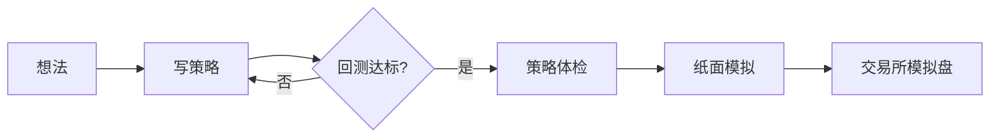
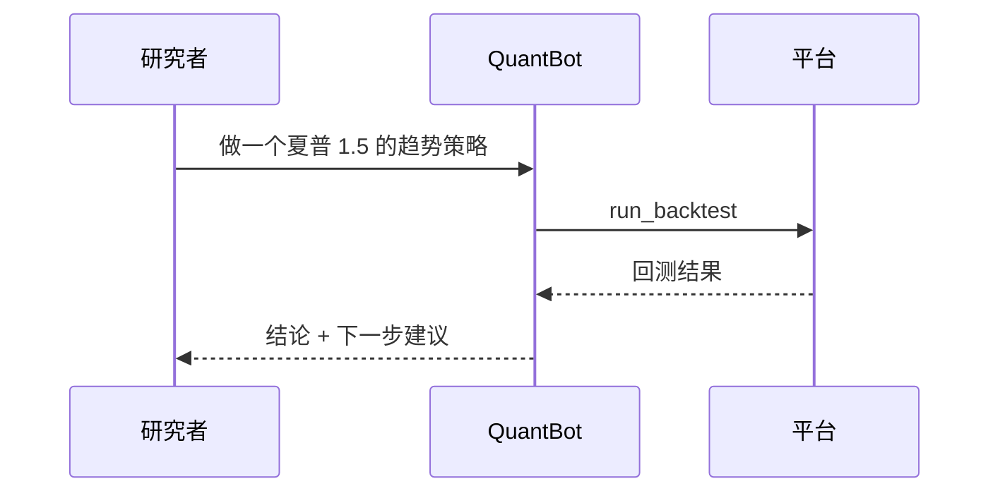

# QuantLab 内容显示能力演示

这篇文档把平台支持的所有显示格式各用一次。**AI 研究室的对话、策略广场的帖子、调研报告、群聊消息**用的是同一套渲染器，写法完全一样。复制下面任意一段到对话框或发帖页，就能看到同样的效果。

> [!NOTE]
> 所有原生 HTML 都会先经过安全过滤：脚本、样式表、iframe、表单、事件属性（如 `onclick`）会被去掉，其余照常显示。

## 1. 标题层级

# 一级标题
## 二级标题
### 三级标题
#### 四级标题
##### 五级标题
###### 六级标题

Setext 写法的标题
---

## 2. 行内格式

**粗体**、*斜体*、***粗斜体***、~~删除线~~、==高亮==、`行内代码`、<kbd>Ctrl</kbd> + <kbd>Enter</kbd>、H<sub>2</sub>O、x<sup>2</sup>、<mark>HTML 高亮</mark>。
转义字符：\*这不是斜体\*，金额写成 100 USDT 或 $100 都不会被当成公式。
链接：[平台首页](#/home)、自动链接 <https://www.binance.com>、裸链接 https://www.okx.com 。
行尾两个空格  
可以强制换行。

## 3. 列表

- 无序列表
  - 嵌套第二层
    - 嵌套第三层
- 列表里也能放代码：

  ```python
  print("列表里的代码块")
  ```

3. 有序列表可以从任意数字开始
4. 第二项
   1. 嵌套的有序列表
   2. 第二项

- [x] 已完成的任务
- [ ] 未完成的任务

## 4. 表格（可对齐、可复制）

| 指标 | 定义 | 策略 A | 策略 B |
| :--- | :---: | ---: | ---: |
| 夏普 | 年化收益 / 年化波动 | 1.42 | 0.87 |
| 最大回撤 | 峰值到谷底的最大跌幅 | -12.3% | -21.6% |
| 胜率 | 盈利交易占比 | 54% | 47% |

鼠标移到表格上，右上角有「复制」，粘到 Excel / 飞书表格能保持行列。

## 5. 数学公式

行内公式：夏普比率 $\text{Sharpe} = \frac{\mu - r_f}{\sigma}\sqrt{N}$，其中 $N$ 是每年的周期数。

独立公式：

$$
\text{DSR} = \Phi\left(\frac{(\widehat{SR} - SR_0)\sqrt{T-1}}{\sqrt{1 - \hat\gamma_3 \widehat{SR} + \frac{\hat\gamma_4 - 1}{4}\widehat{SR}^2}}\right)
$$

多行推导：

$$
\begin{aligned}
r_t &= \ln\frac{P_t}{P_{t-1}} \\
\sigma_{\text{ann}} &= \sqrt{N}\cdot \operatorname{std}(r_t)
\end{aligned}
$$

## 6. Mermaid 图





## 7. 内联 SVG 示意图

```svg
<svg viewBox="0 0 320 120" xmlns="http://www.w3.org/2000/svg" fill="none" stroke="currentColor">
  <polyline points="10,90 60,70 110,80 160,40 210,55 260,20 310,35" stroke-width="2"/>
  <line x1="10" y1="60" x2="310" y2="60" stroke-dasharray="4 4" opacity="0.5"/>
  <text x="14" y="56" font-size="11" fill="currentColor" stroke="none">止损线</text>
  <circle cx="160" cy="40" r="4" fill="currentColor"/>
  <text x="166" y="36" font-size="11" fill="currentColor" stroke="none">入场</text>
</svg>
```

## 8. 原生 HTML

<details>
<summary>点开查看：可折叠的长内容（里面照样写 Markdown）</summary>

折叠块里可以写**任何 Markdown**：

- 列表
- 公式 $E = mc^2$

| 列 1 | 列 2 |
| --- | --- |
| a | b |

</details>

<table>
  <thead>
    <tr><th rowspan="2">标的</th><th colspan="2">2025 年</th></tr>
    <tr><th>收益</th><th>回撤</th></tr>
  </thead>
  <tbody>
    <tr><td>BTC/USDT</td><td>+38.2%</td><td>-18.4%</td></tr>
    <tr><td>ETH/USDT</td><td>+21.7%</td><td>-27.9%</td></tr>
  </tbody>
</table>

<p align="center"><b>居中的 HTML 段落</b></p>

## 9. 代码块

```python title=strategy.py {3}
def initialize(ctx):
    set_benchmark("BTC/USDT")
    set_order_cost({"taker_fee": 0.0005, "slippage_bps": 3})
```

```diff
- ma_fast = 10
+ ma_fast = 12
```

## 10. 提示框

> [!TIP]
> 回测前先用 `sync_market_data` 同步行情。

> [!WARNING]
> 分段回测的各段收益不能直接相加。

> [!CAUTION]
> 平台全程仿真，不会实盘下单。

## 11. 结构化内容块（Agent 专用）

```ql:metrics
{"items": [{"key": "sharpe", "value": 1.42, "evidence": "measured"}, {"key": "max_drawdown", "value": -0.123, "evidence": "measured"}, {"key": "win_rate", "value": 0.54}]}
```

```ql:chart
{"kind": "bar", "title": "月度收益（示例数据）", "x": ["1月", "2月", "3月", "4月"], "series": [{"name": "策略", "data": [0.021, -0.008, 0.034, 0.012]}], "y_format": "pct"}
```

```ql:callout
{"tone": "info", "title": "示例数据", "text": "本节的数字只用于演示显示效果，不是任何真实回测结果。"}
```

## 12. 脚注与引用

DSR 用来修正多次试验带来的夏普虚高[^dsr]，概率夏普见 Bailey 与 López de Prado 的论文[^psr]。

[^dsr]: Deflated Sharpe Ratio：按试验次数、收益偏度与峰度修正后的夏普。
[^psr]: Bailey, D. & López de Prado, M. (2012). The Sharpe Ratio Efficient Frontier.

---

<p align="center">— 演示结束 —</p>
