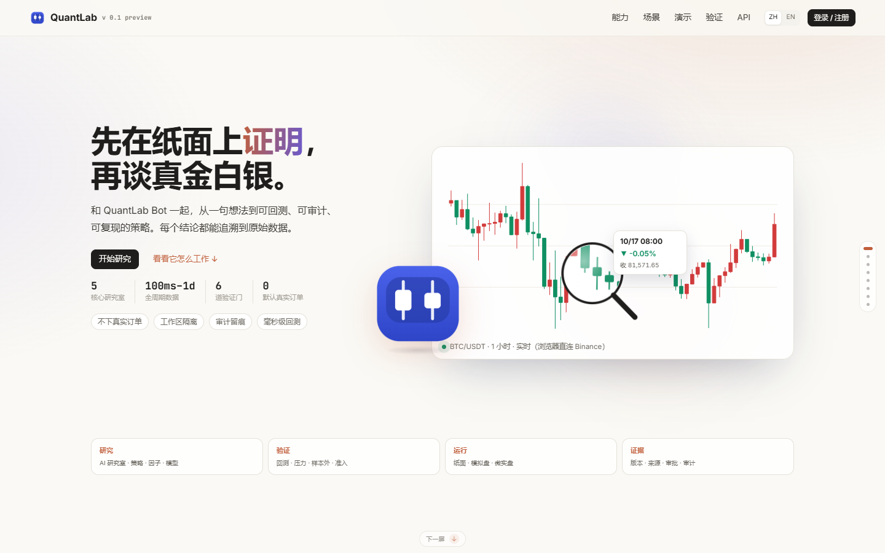
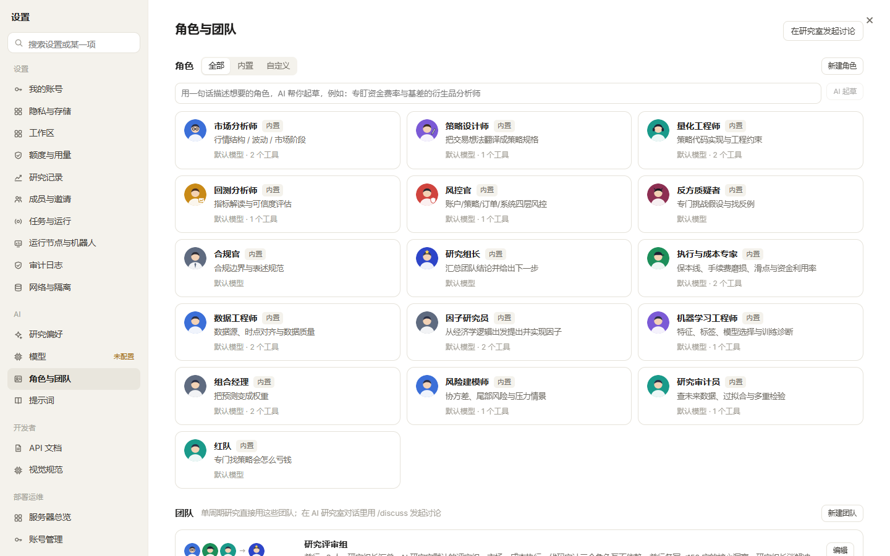
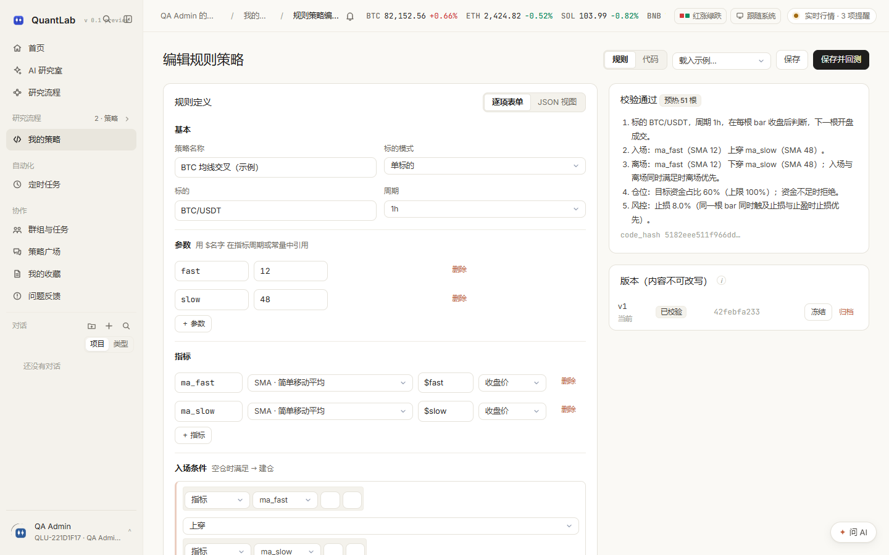
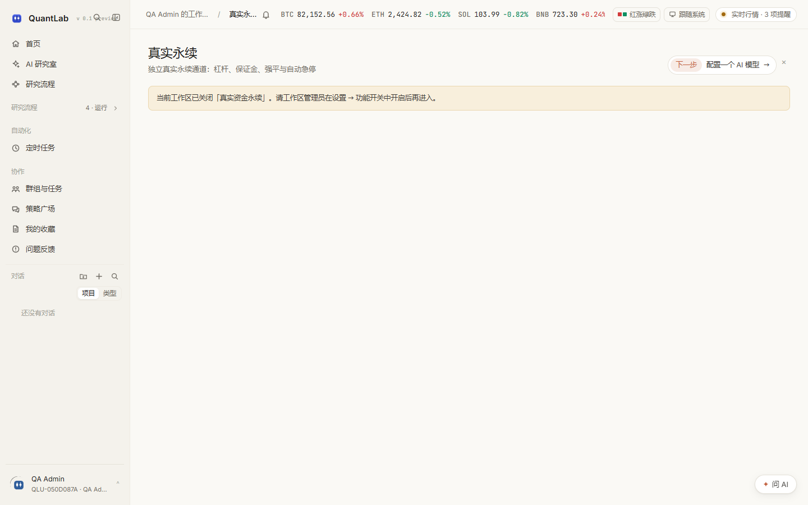
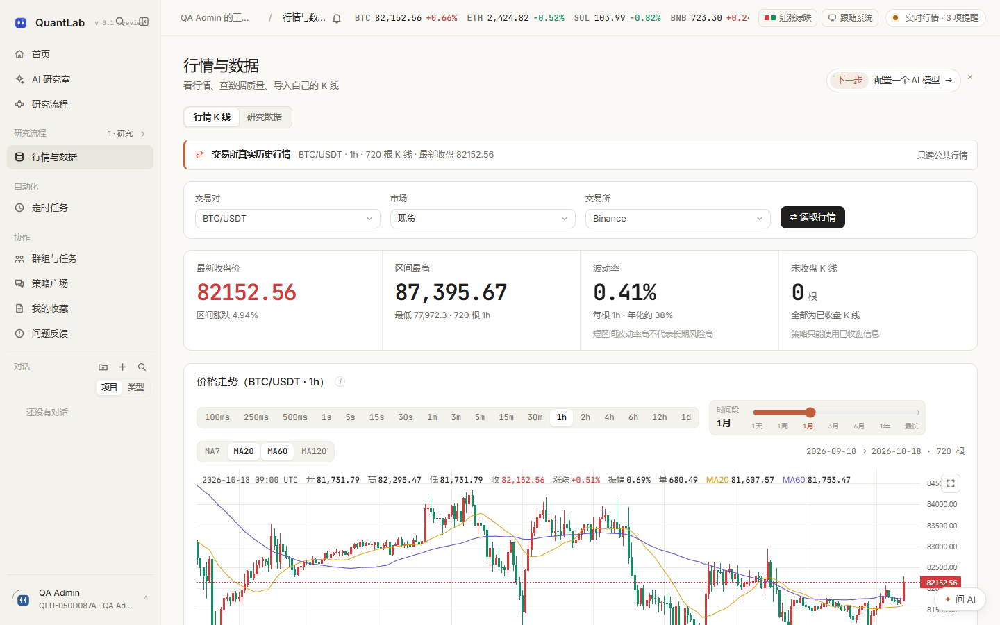
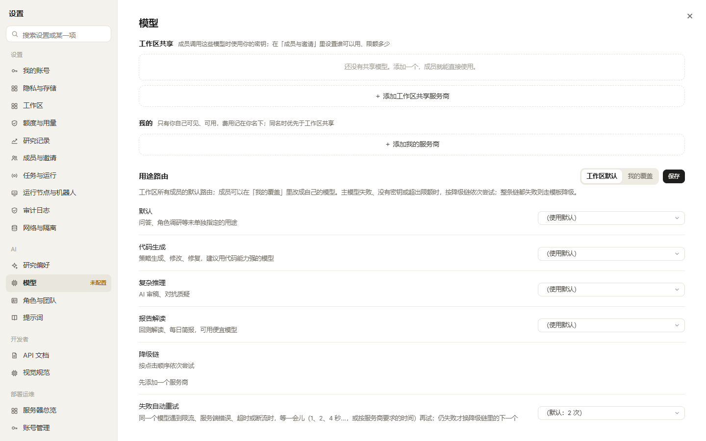

# QuantLab v 0.1 preview · 平台介绍

> 版本：`v 0.1 preview` · 最后更新：2026-10-18
>
> 一句话：**以 AI 研究室为核心的加密货币量化研究与仿真验证平台**。默认只读 / 模拟；微实盘是一条默认关闭、需显式开启的小额真实资金通道。

[English](Platform-Introduction.en.md) | [文档索引](README.md) | [返回 README](../README.md)

---

## 1. 平台定位

QuantLab 把量化研究拆成一条可审计的流水线：

1. **提出假设**：在 AI 研究室用自然语言描述想法，或从策略模板开始；
2. **写策略**：规则 DSL（零代码）或聚宽式 Python SDK；
3. **回测**：事件驱动、Decimal 账本、完整运行清单；
4. **稳健性检验**：样本内 / 样本外、walk-forward、PBO / CSCV、成本压力测试；
5. **上线验证**：回测 → 纸面模拟 → 交易所模拟盘，逐关人工确认；
6. **小额真实验证**：已毕业策略可在微实盘中用很小金额运行；
7. **实盘对照**：导入真实成交，逐笔归因执行缺口、滑点与时机。



### 不适合什么

- ❌ 不托管资金；
- ❌ 不提供投资建议，不承诺收益；
- ❌ 不做高频做市；
- ❌ 默认不向交易所下真实订单。

> **真实资金是设计的一部分。** 微实盘支持 Binance / OKX 现货；真实永续是独立通道，只支持 Binance/OKX 线性 USDT-M。两者都默认关闭，分别需要部署者开关、工作区管理员确认和每次启动确认。

---

## 2. 首页与研究工作台

首页把“今天研究什么”放在第一位：

- 对话式研究入口：直接描述目标，AI 选择研究类型；
- 自选标的与实时 K 线；
- 最近回测、运行中的纸面模拟、待审阅策略；
- 上线验证进度、研究流水线、需要留意的提醒。


### 2.1 研究流程：一页看见完整研究闭环

研究流程不是静态功能目录，而是把“下一步该做什么、产出什么、哪一步可能不可信”放在同一条工作线上：

- **7 个阶段**：数据与市场 → 假设与因子 → 策略构建 → 预测模型 → 组合与执行 → 验证与可复现 → 运行与复盘；
- **56 个阶段入口**：每个阶段给出明确产出物，并可直接进入行情、因子、策略、回测、验证、模拟或真实资金页面；
- **27 个跨阶段能力**：研究保障、导入导出、协作复用、研究配置与运行入口集中展示，包含 Review Gate、双基准、账本 v2、研究包、导师课程、角色库、提示词库、模型服务、群组任务、通知、问题反馈、收藏与 API 工具参考；
- **状态与 AI 入口**：实时搜索、分类筛选、导师进度、真实永续安全状态、工作区功能开关状态和每个阶段的“让 AI 统筹”入口都在同一页；
- **覆盖审计**：`npm run qa:research` 会把 `PageKey` 与研究流程入口逐项对齐，新增页面必须明确进入流程，或声明为详情页 / 非研究页面。

---

## 3. AI 研究室

### 3.1 七种研究类型

| 类型 | 做什么 | 典型产出 |
|---|---|---|
| 自动 | AI 判断该用哪种研究 | 自动路由到策略 / 因子 / 模型 / 组合 / 执行 |
| 策略 | 写代码或 DSL → 回测 → 改进 | 策略草稿、回测报告、改进建议 |
| 因子 | 提假设 → 写表达式 → IC / 分层 / 衰减 | 因子评估、入库建议 |
| 模型 | 选标签 → 训练 → 泄漏检查 → 上线 | 模型诊断、实验对比 |
| 组合 | 选优化器与约束 → 压力测试 | 权重、风险报告、压力情景 |
| 执行 | 拆单算法仿真与成本对比 | 执行方案、TCA、容量曲线 |
| 完整流程 / 调研报告 | 一次走完多个阶段，或联网调研 | 结构化报告、引用来源 |


### 3.2 工具、角色与命令

- **51 个 Agent 工具**：行情、回测、优化、因子、模型、组合、执行、协作、报告等；
- **16 个内置角色**：市场分析师、策略设计师、量化工程师、回测分析师、风控官、反方质疑者、合规官、研究组长、执行与成本专家、数据工程师、因子研究员、机器学习工程师、组合经理、风险建模师、研究审计员、红队；
- **21 个研究室斜杠命令** + **51 个工具命令** + **7 个首页命令**；
- 团队评审支持并行发言、冲突消解、红队质疑和研究纪律核验。



### 3.3 后台任务主动跟进

- 回测、调参、压力演练在后台完成后，AI 主动回到对话汇报；
- AI 自己查到结果时，取消对应的重复跟进；
- 对话正在等待用户回答（审批卡 / 提问）时，只把结果写入对话并通知，不另起回合冲掉问题。

### 3.4 研究导师


首页提供七课研究导师：研究假设、数据时点、信号因果、回测与基准、稳健性与多重检验、永续风险、执行与上线。每课包含检查项、练习和红旗；完成进度按用户保存。导师内容与回测审查卡、Agent 系统提示共用同一套边界，不以课程完成代替策略晋级。

---

## 4. 策略开发

### 4.1 规则 DSL v2

- 指标：SMA / EMA / RSI / ATR / highest / lowest / return；
- 条件：比较、穿越、逻辑、连续；
- 多标的轮动 `rank{}`；
- 风控：止损、止盈、日交易数、回撤暂停、资金不足处理；
- 上限：12 个指标 / 60 个节点 / 深度 6；
- 表单与 JSON 共用一份 schema，服务端是唯一裁判。

### 4.2 Python SDK

- 聚宽式 API：`initialize`、`run_daily`、`history`、`order_target_percent`、`set_benchmark`、`set_universe`、`set_order_cost` 等；
- 52 个注入名；
- 同一份策略文件可在回测、纸面模拟、实盘对照中使用；
- Python 策略在独立子进程中执行；Linux 下可启用资源上限、降权与网络命名空间隔离。

### 4.3 版本与生命周期

```
DRAFT → VALIDATED → FROZEN → ARCHIVED
```

- 版本内容写入后不可改写；
- 改参数会生成新版本；
- `FROZEN` 是进入纸面模拟 / 实盘对照的前置条件。



---

## 5. 回测、优化与验证

### 5.1 回测口径

- 只用**已收盘 bar**，不读取未来数据；
- 下一根 bar 开盘价 ±（半个价差 + 滑点）成交；
- 默认 taker 0.1%，买卖双向；
- 单根 bar 成交不超过该 bar 成交量的 10%；
- 调仓容差：差额小于净值 0.5% 或 10 USDT 不成交；
- 前 N 根 bar 只用于指标预热；
- 合成数据只验证流程，不作为策略结论。

### 5.2 参数优化

- 网格搜索 / Optuna 贝叶斯搜索；
- 多目标优化（收益 + 回撤）；
- 样本内 / 样本外、walk-forward、PBO / CSCV；
- 试验台账按尝试次数修正最好成绩；
- 已算组合写入检查点，恢复后不重算。

### 5.3 上线验证

- 回测关：收益、回撤、交易次数、成本假设、样本外；
- 纸面模拟关：真实行情、独立 worker、检查点恢复；
- 模拟盘关：交易所模拟账户真实撮合；
- 每一关都需要人工确认，不能由 AI 自动晋级。


---

## 6. 运行模式

| 模式 | 资金 | 成交 | 用途 |
|---|---|---|---|
| 回测 | 虚拟 | 历史 K 线撮合 | 评估逻辑、成本与市场适应性 |
| 纸面模拟 | 虚拟 | 实时行情 + 同一套撮合代码 | 前向观察 7 天 / 30 天 |
| 交易所模拟盘 | 虚拟 | 交易所模拟撮合 | 核对真实撮合与 API 链路 |
| 微实盘 | **真实、小额** | 交易所真实撮合 | 已毕业策略的小额真实验证 |
| 实盘对照 | 真实成交导入 | 不交易 | 归因模拟与真实执行的差异 |

### 6.1 纸面模拟

- 独立 worker 执行；
- 每根新收盘 bar 调用一次策略；
- 每处理完一根 bar 写检查点；
- worker 崩溃后恢复，已处理事件与信号不会重复成交；
- 7 天 / 30 天检查点需要真实经过 168 / 720 小时。


### 6.1.1 永续能力边界

| 入口 | 现货 | 永续 |
|---|---|---|
| 原生回测 / AI 研究室 | ✅ Binance / OKX / Bybit | ✅ 线性 USDT-M、币本位反向、交割；逐仓/全仓、单向/对冲 |
| `.qstrat` 策略包 | ✅ | ✅ 线性 / 反向 / 交割包；导入复核标的后缀、合约类型、保证金/持仓模式与标准答案 |
| Freqtrade 导入 | ✅ 现货多头 | ✅ `can_short` / `leverage()`；需工作区开关与衍生品标的 |
| 微实盘 | ✅ Binance / OKX 现货 | ❌ 微实盘保持现货专用 |
| 真实永续 | — | ✅ Binance / OKX 线性 USDT-M；独立开关、确认码、止损、自动急停 |

> 账本 v2 已记录：独立多空腿、position_side 成交归属、账户级权益与联合强平、币本位结算、合约面值、交割到期、资金费结算币种、MMR 档位、强平费用与滑点。交易所规则仍是可审计的研究近似，反向/交割必须用账户账单核验；不能把研究结果描述成交易所生产规则。

### 6.2 真实永续

- 独立服务器开关 `QAGENT_REAL_PERP=1`，不复用 `QAGENT_MICROLIVE`；
- 独立密钥目录与连接集合，Key 必须仅交易、禁提现/划转、绑定 IP；
- 只允许 Binance/OKX 线性 USDT-M，且必须通过期货账户自检；
- 管理员确认码 + 启动前二次自检；
- 单笔名义、总名义、杠杆、日亏上限与保证金模式/持仓模式声明；
- 交易所条件止损必挂；`real_perp.KILL` 文件或一键急停会暂停开仓并尝试平掉全部交易所持仓；
- Agent 只能只读查看安全状态，不能代替用户输入确认码或解除急停。



### 6.3 微实盘

- 只支持 Binance / OKX 现货；
- 服务器开关 `QAGENT_MICROLIVE=1`；
- 工作区管理员读完风险告知并输入确认语；
- API Key 自检：能交易、不能提现 / 划转、绑定 IP 白名单；
- 资金档位：默认 100 / 300 / 1000 USDT，硬上限 10,000 USDT；
- 只允许已毕业策略；
- 交易所止损必挂；挂不上立即暂停开仓；
- 每次启动生成 6 位确认码，5 分钟有效；
- 一键停止：平仓并停止全部微实盘实验。


---

## 7. 数据与行情

- Binance / OKX / Bybit 公共行情；
- 浏览器可直连交易所，减少服务器 IP 请求压力；
- 服务端缓存 + 数据质量检查（缺口、重复、未收盘）；
- 研究数据目录：连接器、字段、数据集、覆盖范围、本地行情文件与缓存摘要；
- 本地行情库按 `(交易所, 标的, 周期)` 分片存储，回测优先读本地，只补缺失的头尾与中间缺口；
- 外部请求按交易所节流，避免同一 IP 突发请求；失败重试有上限，不无限重放；
- CSV 导入自有 K 线；
- 每个数据点带 `source`：`binance | okx | bybit | csv:<id> | synthetic`；
- 取不到真实行情时明确报错，不用合成数据顶替。



---

## 8. 协作、社区与运维

- 工作区 / 成员 / 三级角色（admin / member / reviewer）；
- 群组、私聊、@ 成员、引用回测 / 策略 / 文件、任务摊派；
- 策略广场：冻结代码与回测清单、一键克隆、AI 审稿；
- 通知中心、问题反馈、在线状态；
- TOTP 双因素、审计日志、配额、幂等、CSRF；
- 运维控制台：worker、队列、磁盘、数据库、网络连通性。





---

## 9. 技术架构

```
浏览器（React 18 + TypeScript + Vite）
   │  SSE / WebSocket / 轮询
   ▼
API 进程  qagent serve
   ├─ 鉴权、工作区隔离、CSRF、幂等
   ├─ 只入队，不执行长任务
   └─ 静态站点服务（web/dist）
        │
        ▼
PostgreSQL / SQLite（40 张表）+ JSON 集合存储
        │
        ▼
Worker 进程  qagent worker
   ├─ 回测 / 优化 / 压力演练
   ├─ 纸面模拟常驻驱动
   ├─ AI Agent 回合
   └─ Python 策略隔离子进程
```

- 32 个路由模块；API 操作/路径数量以重新生成的快照为准；
- 12 个迁移 / 40 张表；
- 单租约认领 + fencing 心跳；
- Redis 仅作唤醒通道，缺省退回数据库轮询。

---

## 10. 质量与成熟度

- 1,129 个 pytest 用例通过（另有 4 个跳过）；
- ruff check / format 通过；
- TypeScript 类型检查与生产构建通过；
- Playwright E2E 覆盖登录、DSL、回测、冻结、纸面模拟、CSV、实盘对照、WebSocket 重连；浏览器端 6/6 通过；
- 英文界面逐页巡检：35 个登录页 + 未登录首页无 UI 中文残留（系统错误文本与运行时路径除外）。

更完整的评估见：

- [测试与验证报告](测试与验证报告.md)
- [隔离能力矩阵](隔离能力矩阵.md)

---

## 11. 快速开始

```bash
# Docker Compose
mkdir -p secrets
python -c "from cryptography.fernet import Fernet;print(Fernet.generate_key().decode())" > secrets/secret.key
cp .env.example .env
docker compose up -d --build
```

打开 <http://127.0.0.1:8000>，第一个注册账号成为部署管理员。

本地开发：

```bash
pip install -r requirements-dev.lock
pip install --no-deps -e .
cd web && npm ci && npm run build && cd ..
qagent migrate
qagent worker &
qagent serve
```

---

## 12. 已知限制

1. Windows 下 Python 策略隔离只有进程隔离，没有资源上限、降权与网络命名空间；平台会显示“部分生效”。
2. 微实盘只支持 Binance / OKX 现货；OKX 的 IP 白名单状态依赖交易所接口返回。
3. 反向/交割与全仓/对冲由账本 v2 支持，但交易所规则仍是研究近似；真实永续只支持 Binance/OKX 线性 USDT-M，且必须经过独立安全闭环。
4. 只读同步有回溯上限（Binance 1,000 条、OKX 100 条 / 页）。
5. 回测撮合基于 K 线；盘口队列与冲击在独立执行仿真模块中。
6. 前端循环 chunk 警告已消除，部分研究页共享 chunk 体积仍偏大。

---

## 13. 联系方式

联系邮箱：[luoyangyuan110@gmail.com](mailto:luoyangyuan110@gmail.com)

---

*所有收益结果均为研究数据，不构成投资建议。*
